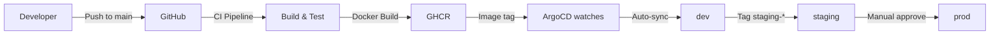

# ArgoCD GitOps Skill — ITS Platform

## When to Use
- Setting up GitOps continuous deployment
- Configuring multi-environment deployments
- Implementing progressive delivery (canary, blue-green)
- Managing application lifecycle via Git

## Architecture

```
GitHub (main) → CI Pipeline → ArgoCD → Kubernetes
                    │
                    ├── dev (auto-sync)
                    ├── staging (tag trigger)
                    └── prod (manual sync)
```

## Project Structure

```
its-platform/
├── .github/workflows/
│   ├── ci.yml          # Build, test, push images
│   └── iac.yml         # Terraform, Helm validation
├── iac/
│   ├── argocd/
│   │   ├── applications/
│   │   │   ├── its-platform-dev.yaml
│   │   │   ├── its-platform-staging.yaml
│   │   │   └── its-platform-prod.yaml
│   │   └── projects/
│   │       └── its-platform.yaml
│   ├── helm/
│   │   └── its-platform/
│   └── terraform/
```

## ArgoCD Project

```yaml
# iac/argocd/projects/its-platform.yaml
apiVersion: argoproj.io/v1alpha1
kind: AppProject
metadata:
  name: its-platform
  namespace: argocd
spec:
  description: ITS Platform microservices
  sourceRepos:
    - "https://github.com/its-platform/its-platform.git"
  destinations:
    - namespace: its-platform-dev
      server: https://kubernetes.default.svc
    - namespace: its-platform-staging
      server: https://kubernetes.default.svc
    - namespace: its-platform-prod
      server: https://kubernetes.default.svc
  clusterResourceWhitelist:
    - group: ""
      kind: Namespace
  namespaceResourceWhitelist:
    - group: ""
      kind: "*"
  roles:
    - name: developer
      description: Read-only access to dev
      policies:
        - p, proj:its-platform:developer, applications, get, its-platform/*, allow
    - name: sre
      description: Full access to all environments
      policies:
        - p, proj:its-platform:sre, applications, *, its-platform/*, allow
```

## Applications

### Dev (Auto-sync)
```yaml
# iac/argocd/applications/its-platform-dev.yaml
apiVersion: argoproj.io/v1alpha1
kind: Application
metadata:
  name: its-platform-dev
  namespace: argocd
  finalizers:
    - resources-finalizer.argocd.argoproj.io
spec:
  project: its-platform
  source:
    repoURL: https://github.com/its-platform/its-platform.git
    targetRevision: main
    path: iac/helm/its-platform
    helm:
      valueFiles:
        - values.yaml
        - values-dev.yaml
      parameters:
        - name: global.environment
          value: "dev"
  destination:
    server: https://kubernetes.default.svc
    namespace: its-platform-dev
  syncPolicy:
    automated:
      prune: true
      selfHeal: true
      allowEmpty: false
    syncOptions:
      - CreateNamespace=true
      - PrunePropagationPolicy=foreground
      - PruneLast=true
    retry:
      limit: 5
      backoff:
        duration: 5s
        factor: 2
        maxDuration: 3m
  ignoreDifferences:
    - group: apps
      kind: Deployment
      jsonPointers:
        - /spec/replicas  # HPA manages replicas
```

### Staging (Tag-based)
```yaml
# iac/argocd/applications/its-platform-staging.yaml
spec:
  source:
    targetRevision: "staging-*"
  syncPolicy:
    automated:
      prune: true
      selfHeal: true
```

### Prod (Manual)
```yaml
# iac/argocd/applications/its-platform-prod.yaml
spec:
  source:
    targetRevision: "v*"
  syncPolicy:
    automated:
      prune: true
      selfHeal: true
    # NO automated.sync — manual approval required
```

## Environment Promotion Flow

```
main branch
    │
    ▼
┌─────────────┐
│   dev       │  Auto-sync on push to main
└─────────────┘
    │
    ▼ (PR to promotion branch or manual)
┌─────────────┐
│   staging   │  Auto-sync on tag `staging-*`
└─────────────┘
    │
    ▼ (Manual approval in ArgoCD UI)
┌─────────────┐
│   prod      │  Manual sync on tag `v*`
└─────────────┘
```

## GitOps Workflow



## Sync Waves (Progressive Delivery)

```yaml
# In Application spec
spec:
  syncPolicy:
    syncOptions:
      - CreateNamespace=true
    retry:
      limit: 5
      backoff:
        duration: 5s
        factor: 2
        maxDuration: 3m
  # Sync waves for ordered deployment
  # Wave 0: CRDs, namespaces, RBAC
  # Wave 1: Infra (PostgreSQL, Redis, Kong)
  # Wave 2: Core services
  # Wave 3: Application services
```

## ArgoCD Notifications (Slack)

```yaml
# argocd-notifications-cm ConfigMap
apiVersion: v1
kind: ConfigMap
metadata:
  name: argocd-notifications-cm
data:
  service.slack: |
    token: $SLACK_TOKEN
  trigger.on-sync-succeeded: |
    - when: app.status.sync.status == "Synced"
      send: [slack]
  trigger.on-sync-failed: |
    - when: app.status.sync.status == "Error"
      send: [slack]
  template.app-sync-status: |
    message: |
      Application {{.app.metadata.name}} is now {{.app.status.sync.status}}
      Environment: {{.app.spec.destination.namespace}}
      Revision: {{.app.status.sync.revision}}
```

## Validation Checklist
- [ ] AppProject defines source repos, destinations, RBAC
- [ ] Dev: auto-sync on main branch
- [ ] Staging: auto-sync on `staging-*` tags
- [ ] Prod: manual sync on `v*` tags
- [ ] Sync waves for ordered deployment
- [ ] `ignoreDifferences` for HPA-managed replicas
- [ ] Slack notifications on sync status
- [ ] SealedSecrets/External Secrets for secret management
- [ ] DR: `argocd admin export` backup schedule