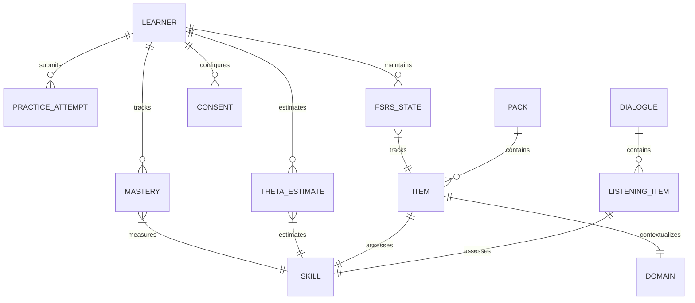

# Database Design Skill — ITS Platform

## When to Use
- Creating/modifying ERD models
- Writing SQLAlchemy 2.0 async models
- Creating Alembic migrations
- Implementing Row-Level Security (RLS)
- Configuring pgBackRest backup
- Query optimization and indexing

## Workflow

### 1. ERD Modeling (Mermaid + SQL DDL)


```sql
-- Core tables (from its-platform/docs/data-model.erd.md)
CREATE TABLE learners (
    id              UUID PRIMARY KEY DEFAULT gen_random_uuid(),
    created_at      TIMESTAMPTZ NOT NULL DEFAULT now(),
    cefr_level      VARCHAR(3) NOT NULL CHECK (cefr_level ~ '^A[12]|B[12]|C[12]$'),
    streak_days     INT NOT NULL DEFAULT 0,
    xp              INT NOT NULL DEFAULT 0,
    last_active_at  TIMESTAMPTZ
);

CREATE TABLE mastery (
    learner_id      UUID NOT NULL REFERENCES learners(id) ON DELETE CASCADE,
    skill_id        VARCHAR(50) NOT NULL REFERENCES skills(id),
    mastery         NUMERIC(4,3) NOT NULL CHECK (mastery BETWEEN 0 AND 1),
    gate_passed     BOOLEAN NOT NULL DEFAULT false,
    last_practice_at TIMESTAMPTZ,
    updated_at      TIMESTAMPTZ NOT NULL DEFAULT now(),
    PRIMARY KEY (learner_id, skill_id)
);

-- Enable RLS
ALTER TABLE mastery ENABLE ROW LEVEL SECURITY;
CREATE POLICY learner_isolation ON mastery
    FOR ALL TO its_platform_app
    USING (learner_id = current_setting('app.current_learner_id')::uuid)
    WITH CHECK (learner_id = current_setting('app.current_learner_id')::uuid);
```

### 2. SQLAlchemy 2.0 Async Model
```python
# its_platform/db/models/mastery.py
from sqlalchemy import ForeignKey, UniqueConstraint, CheckConstraint
from sqlalchemy.orm import Mapped, mapped_column, relationship
from its_platform.db.base import Base
from uuid import UUID

class Mastery(Base):
    __tablename__ = "mastery"
    __table_args__ = (
        UniqueConstraint("learner_id", "skill_id", name="uq_mastery_learner_skill"),
        CheckConstraint("mastery BETWEEN 0 AND 1", name="ck_mastery_bounds"),
    )
    
    learner_id: Mapped[UUID] = mapped_column(ForeignKey("learners.id", ondelete="CASCADE"), primary_key=True)
    skill_id: Mapped[str] = mapped_column(primary_key=True)
    mastery: Mapped[float] = mapped_column(default=0.0)
    gate_passed: Mapped[bool] = mapped_column(default=False)
    last_practice_at: Mapped[datetime | None]
    updated_at: Mapped[datetime] = mapped_column(default=func.now(), onupdate=func.now())
    
    # Relationships
    learner: Mapped["Learner"] = relationship(back_populates="mastery_records")
    skill: Mapped["Skill"] = relationship(back_populates="mastery_records")
```

### 3. Alembic Migration
```python
# alembic/versions/20260101_000001_create_mastery.py
from alembic import op
import sqlalchemy as sa

revision = "20260101_000001"
down_revision = "20260101_000000"
branch_labels = None
depends_on = None

def upgrade():
    op.create_table(
        "mastery",
        sa.Column("learner_id", sa.UUID(), sa.ForeignKey("learners.id", ondelete="CASCADE"), primary_key=True),
        sa.Column("skill_id", sa.String(50), primary_key=True),
        sa.Column("mastery", sa.Numeric(4,3), nullable=False, default=0.0),
        sa.Column("gate_passed", sa.Boolean(), nullable=False, default=False),
        sa.Column("last_practice_at", sa.TIMESTAMP(timezone=True)),
        sa.Column("updated_at", sa.TIMESTAMP(timezone=True), nullable=False, server_default=sa.func.now()),
        sa.CheckConstraint("mastery BETWEEN 0 AND 1", name="ck_mastery_bounds"),
        sa.UniqueConstraint("learner_id", "skill_id", name="uq_mastery_learner_skill"),
    )
    op.create_index("ix_mastery_learner", "mastery", ["learner_id"])
    # RLS
    op.execute("ALTER TABLE mastery ENABLE ROW LEVEL SECURITY;")
    op.execute("""
        CREATE POLICY learner_isolation ON mastery
            FOR ALL TO its_platform_app
            USING (learner_id = current_setting('app.current_learner_id')::uuid)
            WITH CHECK (learner_id = current_setting('app.current_learner_id')::uuid);
    """)

def downgrade():
    op.drop_table("mastery")
```

### 3. pgBackRest Config
```ini
# /etc/pgbackrest/pgbackrest.conf
[global]
repo1-type=s3
repo1-path=/its-platform-backups/prod
repo1-s3-bucket=its-platform-pgbackrest
repo1-s3-region=us-east-1
repo1-cipher-type=aes-256-cbc
compress-type=zstd
compress-level=3
process-max=4

[global:archive]
repo1-retention-full=30
repo1-retention-diff=7
repo1-retention-archive=7

[prod]
pg1-path=/var/lib/postgresql/16/main
pg1-port=5432
```

### 4. Query Optimization
```python
# its_platform/db/queries/mastery.py
from sqlalchemy import select
from sqlalchemy.orm import selectinload
from its_platform.db.models.mastery import Mastery

async def get_learner_mastery(learner_id: UUID, db: AsyncSession) -> list[Mastery]:
    stmt = (
        select(Mastery)
        .where(Mastery.learner_id == learner_id)
        .options(selectinload(Mastery.skill))
        .order_by(Mastery.updated_at.desc())
    )
    result = await db.execute(stmt)
    return result.scalars().all()
```

## Validation Checklist
- [ ] ERD updated in `docs/data-model.erd.md` (Mermaid + SQL)
- [ ] SQLAlchemy models use `Mapped`, `mapped_column`, strict typing
- [ ] RLS policies on ALL learner-scoped tables
- [ ] Alembic migration: up/down tested, reversible
- [ ] Indexes for query patterns (composite where needed)
- [ ] pgBackRest config: S3 + KMS + continuous WAL
- [ ] Weekly automated restore test in CI
- [ ] `verify-integrity.py` passes after schema changes