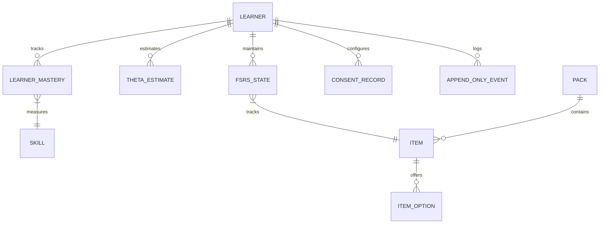

# Database Design Skill — ITS Platform

## When to Use
- Creating/modifying ERD models (source of truth: `its-platform/docs/data-model.erd.md` v1.0.0)
- Writing TypeORM 0.3.x entities (NestJS 10 + `@nestjs/typeorm`)
- Creating TypeORM migrations (`synchronize: false`)
- Implementing Row-Level Security (ERD §9 — 15 learner-scoped tables)
- Configuring pgBackRest backup
- Query optimization and indexing

## ⚠️ READ FIRST — what the derived ERD abolished

The persistence contract is `data-model.erd.md` v1.0.0, re-derived from the six `specs/`
files via ADR-018. The following v0.1.0-draft artifacts are **deleted and must never
return** (ADR-018 §9 corrections + invariant floor):

| Deleted | Replacement |
|---|---|
| `learners.cefr_level`, `streak_days`, `xp` | corrections 9/10 — CEFR is a projection of the latest completed `diagnostic_results`, read at query time; gamification has no persistence (ADR-015 §3) |
| `mastery` table name | `learner_mastery` (correction 8 — it is current state; history lives in `append_only_events`) |
| `mastery.gate_passed` (+ trigger) | domain function L-2 over the evidence columns (`p_know`, `n_obs`, `distinct_days`, `spaced_obs`) — never stored (ERD §8 row 1) |
| `retrievability` | computed `R(t) = (1 + FACTOR·t/S)^DECAY` in the domain (ERD §8 row 3) |
| `content_embeddings` / pgvector | P3, waiting for a named consumer (ERD §10) |
| `learner_preferences` | domain defaults; `consent_records` holds purposes, not preferences |
| SQLAlchemy / Alembic stack | TypeORM ^0.3.20 — the Python tree (`src/its_platform/`, `pyproject.toml`) is deleted at P0.9 |

**If a source (docs, skill, old migration) shows any of the deleted artifacts, it is stale.
The derived ERD supersedes it.**

## Workflow

### 1. ERD — read the contract, don't reinvent it

The ERD v1.0.0 is authoritative and **complete**: 33 tables, every column naming its spec
`§` (§0), §2 acceptance ledger (16 corrections), §6 DDL, §7 vocabulary ledger, §8 derived-
never-stored, §9 RLS, §10 open items, §11 migration path. Read the relevant § before
authoring any entity. Learner-scoped aggregates (schematic only — details in ERD §6):



### 2. DDL baseline (ERD §6.5 — verbatim shape)

```sql
CREATE TABLE learners (
    id             UUID PRIMARY KEY DEFAULT gen_random_uuid(),
    created_at     TIMESTAMPTZ NOT NULL DEFAULT now(),
    last_active_at TIMESTAMPTZ,
    updated_at     TIMESTAMPTZ NOT NULL DEFAULT now()
);
-- corrections 9/10/11 removed: cefr_level, streak_days, xp, consent_given_at.
-- Current CEFR = latest completed diagnostic_results.cefr, read at query time.

CREATE TABLE learner_mastery (
    learner_id       UUID NOT NULL REFERENCES learners(id) ON DELETE CASCADE,
    skill_id         VARCHAR(50) NOT NULL REFERENCES skills(id),
    p_know           NUMERIC(4,3) NOT NULL CHECK (p_know BETWEEN 0 AND 1),
    n_obs            INT NOT NULL DEFAULT 0,
    distinct_days    INT NOT NULL DEFAULT 0,
    spaced_obs       INT NOT NULL DEFAULT 0,
    last_practice_at TIMESTAMPTZ,
    updated_at       TIMESTAMPTZ NOT NULL DEFAULT now(),
    PRIMARY KEY (learner_id, skill_id)
);
-- gate_passed is DELETED (invariant floor). The gate is a domain function L-2
-- over the evidence columns (ERD §8 row 1).
```

### 3. TypeORM 0.3.x Entity

Rules enforced by ADR-014:
- **`@Entity()` only inside `src/infrastructure/entities/`** — never in `src/domain/`
  (the `domain:check` script fails otherwise).
- Entity file name: `*.entity.ts` (data-source globs `dist/**/*.entity{.js,.ts}`).
- Column names in the DB are `snake_case`; map with `name:` so domain code stays camelCase.

```typescript
// src/infrastructure/entities/learner-mastery.entity.ts
import { Column, Entity, PrimaryColumn } from 'typeorm';

@Entity('learner_mastery')
export class LearnerMasteryEntity {
  @PrimaryColumn({ type: 'uuid' })
  learnerId: string;

  @PrimaryColumn({ name: 'skill_id', type: 'varchar', length: 50 })
  skillId: string;

  // NUMERIC arrives from the pg driver as string — map to number in the domain layer.
  @Column({ name: 'p_know', type: 'numeric', precision: 4, scale: 3 })
  pKnow: string;

  @Column({ name: 'n_obs', type: 'int' })
  nObs: number;

  @Column({ name: 'distinct_days', type: 'int' })
  distinctDays: number;

  @Column({ name: 'spaced_obs', type: 'int' })
  spacedObs: number;

  @Column({ name: 'last_practice_at', type: 'timestamptz', nullable: true })
  lastPracticeAt: Date | null;

  @Column({ name: 'updated_at', type: 'timestamptz', default: () => 'now()' })
  updatedAt: Date;
}
```

Portability notes (validated against TypeORM ^0.3.20):
- UUID PK: `@PrimaryGeneratedColumn('uuid')` (generated) or `@PrimaryColumn({ type: 'uuid' })` (assigned).
- `text[]` / `jsonb`: `@Column({ type: 'text', array: true })` (e.g. `packs.item_ids`,
  `items.skill_ids`, `items.clip_ids`) and `@Column({ type: 'jsonb' })` (e.g.
  `packs.manifest`, `items.diff_flags`, `items.skill_theta`, `items.bkt_priors_override`).
- Partial unique index (e.g. `uq_item_options_one_key` — exactly one key per item):
  `@Index(['itemId'], { unique: true, where: '"is_key" IS TRUE' })`.
- GIN indexes (`items.skill_ids`, `packs.item_ids`) have **no decorator** — raw SQL in the
  migration with `@Index(..., { synchronize: false })` on the entity if you want metadata.

### 4. TypeORM Migration

`data-source.ts` sets `synchronize: false` (prod default) — schema changes go through
migrations in `src/migrations/`. **CHECKs, GIN indexes, partial unique indexes, RLS
policies, triggers, roles and grants are NOT expressible in decorators — raw SQL via
`QueryRunner`, always inside the migration.**

```typescript
// src/migrations/1696600000000-CreateLearnerMastery.ts
import { MigrationInterface, QueryRunner } from 'typeorm';

export class CreateLearnerMastery1696600000000 implements MigrationInterface {
  name = 'CreateLearnerMastery1696600000000';

  public async up(queryRunner: QueryRunner): Promise<void> {
    await queryRunner.query(`
      CREATE TABLE learner_mastery (
        learner_id       UUID NOT NULL REFERENCES learners(id) ON DELETE CASCADE,
        skill_id         VARCHAR(50) NOT NULL REFERENCES skills(id),
        p_know           NUMERIC(4,3) NOT NULL CHECK (p_know BETWEEN 0 AND 1),
        n_obs            INT NOT NULL DEFAULT 0,
        distinct_days    INT NOT NULL DEFAULT 0,
        spaced_obs       INT NOT NULL DEFAULT 0,
        last_practice_at TIMESTAMPTZ,
        updated_at       TIMESTAMPTZ NOT NULL DEFAULT now(),
        PRIMARY KEY (learner_id, skill_id)
      )
    `);
    await queryRunner.query(
      `CREATE INDEX idx_mastery_learner ON learner_mastery (learner_id)`
    );
  }

  public async down(queryRunner: QueryRunner): Promise<void> {
    await queryRunner.query(`DROP TABLE learner_mastery`);
  }
}
```

Migration hygiene:
- Every migration must be verified **up → down → up** (PGlite for speed; **real
  PostgreSQL for anything touching RLS/GUCs** — PGlite cannot exercise `SET LOCAL` or
  `current_setting`; a green PGlite run proves nothing there, ADR-014).
- Never hand-edit the `migrations` table; use `typeorm migration:run` / `migration:revert`.

### 5. Row-Level Security (ERD §9)

**The 15 learner-scoped tables** (policy on every one; a learner-scoped table with no
policy is a P0 defect): `learners` (predicate on `id`), `sessions`, `learner_mastery`,
`theta_estimates`, `fsrs_states`, `practice_attempts`, `item_responses`,
`listening_attempts`, `slot_responses`, `diagnostic_results`, `diagnostic_responses`,
`error_log`, `affective_signals`, `consent_records`, `append_only_events` (all on
`learner_id`).

```sql
ALTER TABLE learner_mastery ENABLE ROW LEVEL SECURITY;
CREATE POLICY learner_isolation ON learner_mastery
  FOR ALL TO its_platform_app
  USING      (learner_id = current_setting('app.current_learner_id')::uuid)
  WITH CHECK (learner_id = current_setting('app.current_learner_id')::uuid);
-- plus admin_bypass (TO its_platform_admin) and worker_access (TO its_platform_worker),
-- exactly as ADR-003 specifies.
```

Rules (ERD §9, ADR-003, domain-model X-4):
1. `SET LOCAL app.current_learner_id = '<uuid>'` — **once per transaction**, issued only
   by `PgSessionContext` (single writer). Never in application code outside it.
2. Content tables (contexts 1–3 plus `fsrs_parameters`, `bkt_skill_params`) are **not**
   learner-scoped — no policy.
3. `append_only_events` additionally revokes `UPDATE`/`DELETE` before any policy (X-3):
   RLS scopes reads; immutability is a grant, not a policy.
4. **Verification runs on real PostgreSQL only** (ADR-014).

### 6. pgBackRest Config (ops — ADR-009)

```ini
# /etc/pgbackrest/pgbackrest.conf (operational, not part of P0.x design)
[global]
repo1-type=s3
repo1-path=/its-platform-backups/prod
repo1-s3-bucket=its-platform-pgbackrest
repo1-s3-region=us-east-1
repo1-cipher-type=aes-256-cbc
compress-type=zstd
compress-level=3
process-max=4

[global:archive]
repo1-retention-full=30
repo1-retention-diff=7
repo1-retention-archive=7

[prod]
pg1-path=/var/lib/postgresql/16/main
pg1-port=5432
```

### 7. Query Optimization

Index targets come from ERD §6.9 — rule: **every FK gets an index**, learner-scoped
timelines lead with `learner_id` (the RLS predicate), arrays are GIN:

```sql
CREATE INDEX idx_items_skill_ids ON items USING GIN (skill_ids);
CREATE INDEX idx_packs_item_ids  ON packs USING GIN (item_ids);
CREATE INDEX idx_fsrs_due_queue  ON fsrs_states (due_date);
CREATE INDEX idx_attempts_learner ON practice_attempts (learner_id, started_at DESC);
CREATE INDEX idx_error_log_learner ON error_log (learner_id, skill_id, last_seen_at DESC);
CREATE INDEX idx_events_learner  ON append_only_events (learner_id, occurred_at DESC);
```

TypeORM reads (repository / QueryBuilder):

```typescript
// src/infrastructure/repositories/learner-mastery.repository.ts
import { Injectable } from '@nestjs/common';
import { InjectRepository } from '@nestjs/typeorm';
import { Repository } from 'typeorm';
import { LearnerMasteryEntity } from '../entities/learner-mastery.entity';

@Injectable()
export class LearnerMasteryRepository {
  constructor(
    @InjectRepository(LearnerMasteryEntity)
    private readonly repo: Repository<LearnerMasteryEntity>,
  ) {}

  findByLearner(learnerId: string): Promise<LearnerMasteryEntity[]> {
    return this.repo.find({ where: { learnerId }, order: { updatedAt: 'DESC' } });
  }
}
```

## Validation Checklist

- [ ] ERD §6 consulted before authoring; entity columns/`§` match the ERD (schema-compare
      test recommended: entity metadata vs ERD §6 DDL — prevents the decorator↔migration
      drift that Check [2]/[4] of `verify-integrity.py` cannot see)
- [ ] Entities live **only** in `src/infrastructure/entities/` (`*.entity.ts`);
      `npm run domain:check` green; no `typeorm`/`@nestjs/*` import in `src/domain/`
- [ ] DDL that decorators cannot express is in the migration, raw SQL: CHECKs, GIN,
      partial unique indexes, triggers, roles, grants, `CREATE POLICY` on the **15**
      learner-scoped tables (ERD §9)
- [ ] Migration verified up → down → up; anything RLS/GUC-related on **real PostgreSQL**
      (PGlite proves nothing — ADR-014)
- [ ] No deleted artifacts reintroduced: `gate_passed`, `streak_days`, `xp`,
      `learners.cefr_level`, `retrievability`, `content_embeddings`, `learner_preferences`,
      `mastery`/`mastery_history` naming (ADR-018 floor)
- [ ] Every FK has an index; learner timelines lead with `learner_id`; GIN on
      `items.skill_ids` / `packs.item_ids` (ERD §6.9)
- [ ] `python3 verify-integrity.py` passes after schema changes
- [ ] `db:migrate`/migration scripts wired in `package.json` (currently placeholder —
      P0.4 replaces it)