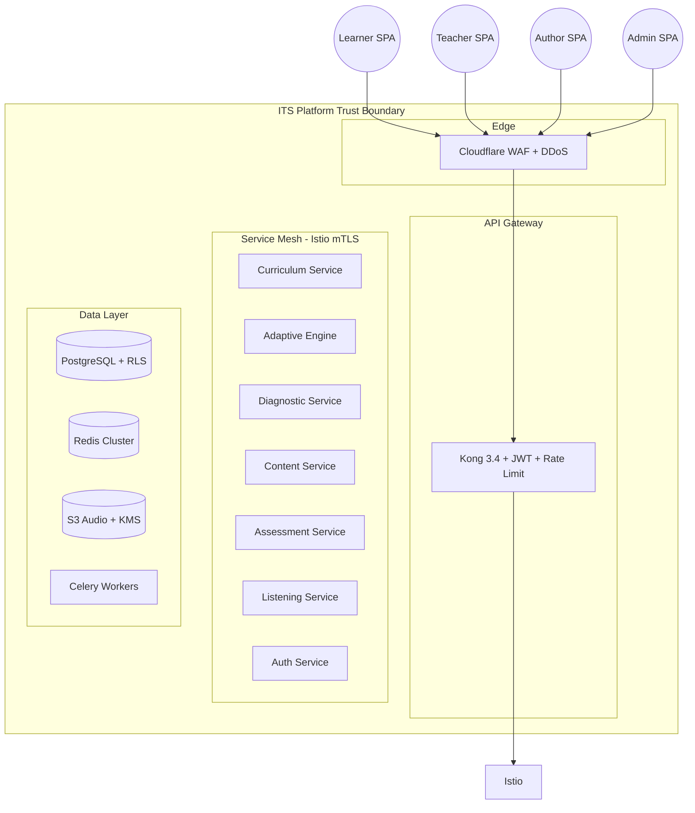

# Threat Modeling Skill — ITS Platform

## When to Use
- Creating/updating threat models
- STRIDE analysis for new features
- MITRE ATT&CK mapping
- Risk assessment and prioritization
- Security architecture reviews

## Workflow

### 1. System Boundary Definition


### 2. STRIDE Analysis Template
```markdown
# Threat Model: [Component/Feature Name]

## Assets
| Asset | Classification | Owner |
|-------|----------------|-------|
| Learner PII | Confidential | Platform |
| Mastery/θ/FSRS | Confidential | Adaptive |
| Audio recordings | **Restricted (Biometric)** | Listening |
| Practice responses | Confidential | Assessment |

## Threats (STRIDE)

### Spoofing
| ID | Threat | Asset | Vector | Likelihood | Impact | Mitigation | Residual |
|----|--------|-------|--------|------------|--------|------------|----------|
| S-01 | JWT token theft | Access tokens | XSS | Medium | High | CSP, httpOnly, 15m TTL | Low |
| S-02 | Refresh token theft | Refresh tokens | CSRF | Low | High | SameSite=Strict, rotation | Low |

### Tampering
| ID | Threat | Asset | Vector | Likelihood | Impact | Mitigation | Residual |
|----|--------|-------|--------|------------|--------|------------|----------|
| T-01 | Mastery/θ manipulation | BKT/IRT state | Direct DB, API | Low | High | RLS, server-only updates, audit log | Low |

### Information Disclosure
| ID | Threat | Asset | Vector | Likelihood | Impact | Mitigation | Residual |
|----|--------|-------|--------|------------|--------|------------|----------|
| I-01 | θ/mastery exposure | Theta estimates | Over-permissive RBAC | Medium | High | ABAC, field-level encryption | Low |

### Denial of Service
| ID | Threat | Asset | Vector | Likelihood | Impact | Mitigation | Residual |
|----|--------|-------|--------|------------|--------|------------|----------|
| D-01 | Adaptive engine overload | BKT/IRT workers | Mass submissions | Medium | High | Async queue, rate limiting | Low |

### Elevation of Privilege
| ID | Threat | Asset | Vector | Likelihood | Impact | Mitigation | Residual |
|----|--------|-------|--------|------------|--------|------------|----------|
| E-01 | Learner → Teacher | Teacher permissions | JWT claim manipulation | Low | High | RS256, claim validation | Low |

## Risk Register
| Risk ID | Threat | Inherent | Residual | Owner | Review |
|---------|--------|----------|----------|-------|--------|
| RISK-01 | Audio exfiltration | Critical | Low | Security | Monthly |
| RISK-02 | Mastery manipulation | High | Low | Adaptive | Monthly |
```

### 3. MITRE ATT&CK Mapping (Cloud Matrix)
```markdown
| Technique | Tactic | Threat IDs | Detection |
|-----------|--------|------------|-----------|
| T1556.001 (Password Spraying) | Credential Access | S-01 | Failed login rate, IP reputation |
| T1550.001 (Pass the Hash) | Credential Access | S-01, S-02 | Token reuse detection |
| T1530 (Data from Cloud Storage) | Collection | I-02 | S3 access logs, anomalous downloads |
| T1213 (Data from Info Repositories) | Collection | I-01, I-04 | API audit logs, RLS violations |
| T1565.001 (Stored Data Manipulation) | Impact | T-01, T-02 | Audit log integrity checks |
| T1485 (Data Destruction) | Impact | R-04 | WORM verification, backup integrity |
| T1611 (Escape to Host) | Privilege Escalation | E-03 | Falco/sysdig alerts |
| T1589.001 (Active Directory Recon) | Reconnaissance | S-03 | WAF blocked requests |
```

## Validation Checklist
- [ ] System boundary diagram current
- [ ] STRIDE table complete for all components
- [ ] ATT&CK mapping covers Cloud matrix
- [ ] Risk register prioritized (Critical/High/Medium/Low)
- [ ] Mitigations mapped to controls (Kong, Istio, RLS, KMS)
- [ ] Review scheduled (quarterly + per major release)