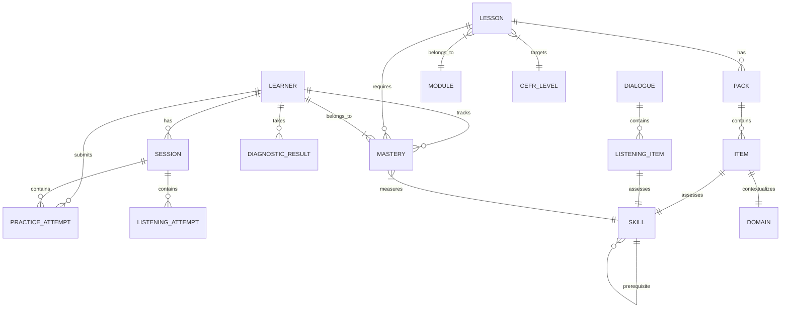

# ITS Architecture — How the Intelligent Tutoring System Consumes This Repository

**Status:** design sketch · **Version:** 0.1 · **Target repo:** separate `its-platform/` (to be created)

---

## 1. Purpose

This document maps each spec/artifact in `Curso-de-Ingles/` to the subsystem in the ITS that consumes it. It is the **contract** between the content repo and the implementation repo.

The ITS is a **Python/FastAPI + React** application with:
- **Adaptive Engine** (BKT/IRT/FSRS) → `stats-progress-evaluation-spec.md`
- **Curriculum Graph Service** (DAG navigation, mastery gating) → `curriculum-graph-spec.md`
- **Diagnostic Service** (placement, IRT θ estimation) → `diagnostic-spec.md`
- **Content Delivery** (lessons, packs, listening) → `lessons/`, `packs/`, `corpus/`
- **Assessment Engine** (item calibration, CAT) → `assessment-item-spec.md`, `post-lesson-practice-spec.md`
- **Authoring/Review Tools** (reuse basis, licence checks) → `external-sources.md`, `verify-integrity.py`

---

## 2. Artifact → Subsystem Mapping

| Spec / Artifact | ITS Subsystem | Consumption Mode | Key Contract |
|---|---|---|---|
| `specs/curriculum-graph-spec.md` | **Curriculum Graph Service** | Loaded at startup → in-memory DAG (NetworkX) | §4.3 registry = canonical node list; edges = prerequisites; `Status` = authored/blocked |
| `lessons/{a1,a2,b1,b2,remediation}/les_*.md` | **Content Delivery / Lesson Renderer** | Fetched on demand by `Lesson ID` | Front-matter: `**Lesson ID:**`, `**Reuse basis:**`, `**Status:**`, 4 FASE blocks, learner-model JSON |
| `packs/{a1,a2,b1,b2,remediation}/pack-*.md` | **Practice Engine** | Fetched by `Pack ID` ↔ `Lesson ID` | Two schemas (canonical + legacy); items with `item_id`, `skill`, `domain`, `Key`, distractors |
| `corpus/listening-corpus.md` | **Listening Service** | Preloaded; filtered by `Status ∈ {shipped, shadow-only}` | 13 dialogues × 82 slots; `lst_*` items with `skill`, `voice`, `duration`, `key` |
| `specs/assessment-item-spec.md` | **Assessment Engine / Item Bank** | Schema validation (Pydantic) + calibration store | §1.2 prefix↔namespace; §6 G-Q3 (3+ options, distinct, one key) |
| `specs/post-lesson-practice-spec.md` | **Practice Engine** | Migration logic (legacy → canonical); `br_pt_form` census | §8 two schemas; §12 migration order; §6 item gates |
| `specs/stats-progress-evaluation-spec.md` | **Adaptive Engine (BKT/IRT/FSRS)** | Parameter initialization; scheduling algorithm | §2 BKT params; §3 IRT; §4 FSRS; mastery ≥ 0.85 |
| `specs/diagnostic-spec.md` | **Diagnostic Service** | Test blueprint; IRT θ estimation; start-node mapping | §2 blueprint; §3 adaptive stopping; §4 start-node rules |
| `specs/listening-corpus-spec.md` | **Listening Service** | Q-L2 validation; voice profile assignment | §3 Q-L2 ≥ 45s; §4 voice profiles; §5 status vocabulary |
| `external-sources.md` | **Authoring Tool / Licence Guard** | Pre-publish check; reuse basis enforcement | §0.5.1 restricted list; §7.0 permission register |
| `content-map.md` | **Authoring Tool / Source Traceability** | Source → lesson mapping; licence warnings | §11.1 P0 term deck; §11.2 Tier B review |
| `verify-integrity.py` | **CI Gate (both repos)** | Runs in `its-platform/` CI on content submodule | 13 checks; exit 0 = green |
| `SDD.md` | **Process Governance** | Amendment procedure for specs | §9 5-step amendment; §10 coverage map |
| `PRD.md` | **Product Scope** | Milestone Entry/Exit criteria; priorities | §9 milestones; §10 falsifiability |

---

## 3. Data Flow (Runtime)

```
┌─────────────────────┐     ┌──────────────────────┐     ┌─────────────────────┐
│  Learner Session    │────▶│  Curriculum Graph    │────▶│  Next Lesson / Pack │
│  (θ, mastery, hist) │     │  Service (DAG)       │     │  Selector (i+1)     │
└─────────────────────┘     └──────────────────────┘     └─────────────────────┘
        │                            │                            │
        │                            │                            ▼
        │                            │                   ┌─────────────────────┐
        │                            │                   │  Content Delivery   │
        │                            │                   │  (lessons/, packs/) │
        │                            │                   └─────────────────────┘
        │                            │                            │
        ▼                            ▼                            ▼
┌─────────────────────┐     ┌──────────────────────┐     ┌─────────────────────┐
│  Adaptive Engine    │◀───│  Assessment Engine   │◀───│  Practice Engine    │
│  (BKT/IRT/FSRS)     │     │  (CAT, calibration)  │     │  (packs, items)     │
└─────────────────────┘     └──────────────────────┘     └─────────────────────┘
        │                            │                            │
        │                            │                            │
        ▼                            ▼                            ▼
┌─────────────────────────────────────────────────────────────────────────────┐
│                         Listening Service (corpus/)                         │
└─────────────────────────────────────────────────────────────────────────────┘
```

---

## 4. Repository Relationship

```
its-platform/                    (NEW REPO - software)
├── .gitmodules                  # Curso-de-Ingles as submodule
├── src/
│   ├── curriculum/              # consumes curriculum-graph-spec.md
│   ├── adaptive/                # consumes stats-progress-evaluation-spec.md
│   ├── diagnostic/              # consumes diagnostic-spec.md
│   ├── assessment/              # consumes assessment-item-spec.md
│   ├── practice/                # consumes post-lesson-practice-spec.md
│   ├── listening/               # consumes listening-corpus-spec.md + corpus/
│   ├── content/                 # consumes lessons/, packs/
│   └── authoring/               # consumes external-sources.md, verify-integrity.py
├── tests/
│   ├── bdd/                     # Gherkin features from PRD §9 milestones
│   ├── contract/                # schema validation (Pydantic ↔ specs)
│   └── property/                # hypothesis tests for BKT/IRT invariants
├── docs/
│   ├── architecture.md          # this file, expanded
│   ├── api-spec.openapi.yaml    # FastAPI auto-generated
│   ├── data-model.erd.md        # SQLAlchemy models → Mermaid
│   ├── security-spec.md         # authN/authZ, PII, LGPD
│   ├── threat-model.md          # STRIDE on learner data
│   ├── runbook.md               # incident response, deploy, rollback
│   └── iac/                     # Terraform (AWS/GCP), Helm (k8s)
├── ADR/
│   ├── 001-use-fastapi.md
│   ├── 002-bkt-irt-hybrid.md
│   └── ...
├── CONSTITUTION.md              # if Spec-Driven Development formalized
├── BACKLOG.md                   # or GitHub Projects / Linear
└── CI/
    └── verify-content.yml       # runs verify-integrity.py on submodule
```

---

## 5. Contract Tests (CI)

Each spec defines **machine-checkable contracts** that become tests in `its-platform/`:

| Spec | Contract Test |
|---|---|
| `curriculum-graph-spec.md` | DAG is acyclic; every `les_*` in §4.3 has a file in `lessons/`; `Status` matches disk |
| `assessment-item-spec.md` | Every item validates against Pydantic model; prefix↔namespace holds; no duplicate options |
| `post-lesson-practice-spec.md` | Legacy pack migration produces canonical schema; `br_pt_form` census matches |
| `stats-progress-evaluation-spec.md` | BKT update preserves [0,1]; IRT θ CI95 narrows with evidence; FSRS intervals monotonic |
| `diagnostic-spec.md` | Blueprint skills ⊆ curriculum skills; stopping rule terminates; start-node ∈ DAG |
| `listening-corpus-spec.md` | All `shipped` items ≥ 45s; voice profiles valid; `Status` ∈ vocabulary |
| `external-sources.md` | No `adapt_*` on restricted source; all `source_derived` items have permission or are `adapt_requires_permission` |

**CI Pipeline:**
```yaml
# its-platform/.github/workflows/ci.yml
jobs:
  contract-tests:
    runs-on: ubuntu-latest
    steps:
      - uses: actions/checkout@v4
        with:
          submodules: recursive
      - name: Verify content integrity
        run: cd Curso-de-Ingles && python3 verify-integrity.py
      - name: Run contract tests
        run: pytest tests/contract/ -v
      - name: Run BDD scenarios
        run: pytest tests/bdd/ -v
```

---

## 6. OpenAPI Surface (Sketch)

```yaml
openapi: 3.1.0
info:
  title: ITS Platform API
  version: 0.1.0
paths:
  /learners/{id}/placement:
    post:
      summary: Run diagnostic, return start node + θ estimate
      requestBody:
        content:
          application/json:
            schema:
              $ref: '#/components/schemas/DiagnosticRequest'
      responses:
        '200':
          description: Placement result
          content:
            application/json:
              schema:
                $ref: '#/components/schemas/PlacementResult'

  /learners/{id}/next:
    get:
      summary: Get next lesson/pack (i+1 selection)
      parameters:
        - name: id
          in: path
          required: true
          schema:
            type: string
      responses:
        '200':
          description: Next activity
          content:
            application/json:
              schema:
                $ref: '#/components/schemas/NextActivity'

  /learners/{id}/practice:
    post:
      summary: Submit practice pack responses
      requestBody:
        content:
          application/json:
            schema:
              $ref: '#/components/schemas/PracticeSubmission'
      responses:
        '200':
          description: Scored results + BKT/IRT/FSRS updates
          content:
            application/json:
              schema:
                $ref: '#/components/schemas/PracticeResult'

  /content/lessons/{lesson_id}:
    get:
      summary: Render lesson (FASE 1-4 + learner-model JSON)
      responses:
        '200':
          description: Lesson content
          content:
            application/json:
              schema:
                $ref: '#/components/schemas/LessonContent'

  /content/packs/{pack_id}:
    get:
      summary: Render practice pack
      responses:
        '200':
          description: Pack with items
          content:
            application/json:
              schema:
                $ref: '#/components/schemas/PackContent'

  /content/listening/{dialogue_id}:
    get:
      summary: Get listening dialogue + items (filtered by Status)
      responses:
        '200':
          description: Dialogue with slots
          content:
            application/json:
              schema:
                $ref: '#/components/schemas/DialogueContent'
```

---

## 7. Data Model (ERD Sketch)



---

## 8. Security & Compliance (To Be Specified in `its-platform/`)

| Concern | Spec Location (Future) |
|---|---|
| **LGPD / GDPR** | `docs/security-spec.md` §3 — learner data minimization, right to erasure |
| **Authentication** | `docs/security-spec.md` §2 — JWT + refresh tokens, PKCE for SPA |
| **Authorization** | `docs/security-spec.md` §4 — RBAC (learner, teacher, admin, author) |
| **PII Handling** | `docs/security-spec.md` §5 — no audio stored without consent; θ estimates encrypted at rest |
| **Threat Model** | `docs/threat-model.md` — STRIDE on: learner profiling, adaptive manipulation, content poisoning |
| **Runbook** | `docs/runbook.md` — deploy, rollback, incident response, data breach notification |

---

## 9. Infrastructure (To Be Specified in `its-platform/iac/`)

| Component | Technology | Rationale |
|---|---|---|
| **API** | FastAPI (Python 3.11+) | async, OpenAPI auto-gen, Pydantic validation |
| **Worker** | Celery + Redis | BKT/IRT updates, CAT scheduling, audio processing |
| **Database** | PostgreSQL + pgvector | relational + embeddings for content search |
| **Cache** | Redis | session state, θ estimates, next-activity precompute |
| **Queue** | Redis Streams | event sourcing for learner actions |
| **Object Store** | S3 / MinIO | audio files, exported reports |
| **Orchestration** | Kubernetes (Helm) | horizontal scaling, blue-green deploy |
| **Observability** | Prometheus + Grafana + OpenTelemetry | SLOs on latency, θ accuracy, mastery convergence |

---

## 10. Milestones (from PRD.md §9)

| Milestone | Entry Criteria | Exit Criteria | ITS Deliverable |
|---|---|---|---|
| **M1: Content Pipeline** | `verify-integrity.py` PASS; 123 lessons, 122 packs, 74 listening items | All contract tests green; submodule sync automated | `its-platform` reads all specs; renders lesson/pack/listening |
| **M2: Curriculum Graph** | DAG loads; 18 modules, 123 nodes, 0 cycles | Mastery gating works; prerequisite traversal correct | `/next` endpoint returns valid i+1 |
| **M3: Adaptive Engine** | BKT/IRT/FSRS params initialized from spec | θ CI95 narrows with evidence; mastery ≥ 0.85 gate holds | `/practice` updates mastery; spaced review scheduled |
| **M4: Diagnostic** | Blueprint skills ⊆ curriculum skills | Placement θ correlates with post-test (r ≥ 0.7) | `/placement` returns start node + confidence |
| **M5: Listening** | 74 admissible items render; Q-L2 ≥ 45s | Shadow CAT runs; `shadow-only` items excluded from scoring | `/listening` streams audio + items |
| **M6: Authoring Guard** | `external-sources.md` enforced in CI | Zero `adapt_*` on restricted; all permissions tracked | Pre-publish check blocks non-compliant content |
| **M7: MVP Release** | All milestones green; security spec reviewed | Load test: 1k concurrent learners < 200ms p95 | Production deploy via Helm |

---

## 11. Amendment Procedure (Mirror of SDD.md §9)

Any change to a spec in `Curso-de-Ingles/` that affects the ITS contract:

1. **Write diff** against current spec, naming affected checks/contracts
2. **Show defect** it was written for (file + section)
3. **State what weakens** — gate that gets weaker must be visible
4. **Record in changelog** (both repos) with date + defect ID
5. **Run both verifiers** before/after; attach runs to PR

`its-platform/` CI fails if `Curso-de-Ingles/` submodule has unverified changes.

---

## 12. Open Questions

| # | Question | Decision Needed By |
|---|---|---|
| 1 | Audio storage: S3 vs. local MinIO vs. CDN? | M5 |
| 2 | Real-time θ updates: WebSocket vs. polling? | M3 |
| 3 | Offline-first: service worker + IndexedDB for lessons? | M7 |
| 4 | ~~Multi-tenant (schools) vs. single-tenant (B2C)?~~ | **CLOSED 2026-10-05 — [ADR-015 §2](its-platform/docs/adr/015-domain-model-bounded-contexts.md): single-tenant B2C.** No `tenant_id`; RLS keeps the ADR-003 per-learner predicate. It was due at M1 and was still open while P0.3 was about to port a `learners` table whose aggregate boundary was undetermined — which is a `Organization` aggregate sitting above `LearnerAccount`, changing every query, every repository signature and every FK. Reopening is a **MAJOR** version bump (`CONSTITUTION.md` §6.1) and a policy rewrite on every learner-scoped table |
| 5 | LLM integration for free-form production scoring? | Post-MVP |
| 6 | Telemetry schema for learning analytics export? | M4 |

---

*This document lives in `Curso-de-Ingles/ITS-ARCHITECTURE.md` as the **interface contract**. The detailed specs (OpenAPI, ERD, Security, Threat Model, Runbook, IaC, ADR, BDD, TDD, BACKLOG, CONSTITUTION) will be authored in `its-platform/` when implementation begins.*