# ITS Platform — Constitution

**Version:** 2.0.0 · **Status:** Ratified
**Governance:** This document governs all technical decisions, processes, and standards for the ITS Platform.
**Target stack:** NestJS · TypeScript · PostgreSQL (see ADR-012, ADR-014). Supersedes the Python/FastAPI prototype.
**Amendment:** See §9 (mirrors `Curso-de-Ingles/SDD.md` §9)

---

## 1. Purpose & Scope

This Constitution establishes the **technical governance** for the ITS Platform repository (`its-platform/`). It defines:

- How decisions are made and recorded
- Quality standards for code, architecture, and delivery
- Roles, responsibilities, and escalation paths
- The amendment process for this document

**Scope:** All code, configuration, documentation, and processes in `its-platform/`.
**Out of scope:** Content repository (`Curso-de-Ingles/`) — governed by its own `SDD.md`.

---

## 2. Principles

| Principle | Description |
|---|---|
| **Spec-First** | No implementation without a spec (`specs/*.md`, `api-spec.openapi.yaml`). Contract tests enforce compliance. |
| **Derivation over Assertion** | Every number in code/docs names its derivation (function, spec section, command). "Magic numbers" are forbidden. |
| **Defense in Depth** | Security at every layer: network (Istio), gateway (Kong), application (RLS, JWT), data (encryption). |
| **Observability by Default** | Every service emits metrics, logs, traces. No "black box" services. |
| **GitOps** | Desired state in Git → ArgoCD → Cluster. No manual `kubectl apply` in prod. |
| **Immutable Infrastructure** | Containers are immutable; config via env/ConfigMap; secrets via Vault/SealedSecrets. |
| **Contract Testing** | Spec ↔ Implementation validated in CI. Breaking changes fail the build. |
| **Blameless Postmortems** | Incidents → learning → action items → prevention. No individual blame. |
| **Documentation as Code** | Docs in `docs/`, versioned with code. `mkdocs` builds to site. |
| **Object-Oriented Design** | Encapsulation, cohesion, low coupling, single responsibility. **Composition over inheritance.** Domain entities are framework-free classes, never ORM or HTTP decorators. |
| **Clean Code & SOLID** | SRP, OCP, LSP, ISP, DIP applied strictly. Names state intent; functions stay short; errors are handled explicitly, never swallowed. |
| **Clean Architecture** | Four layers — `domain/` → `application/` → `infrastructure/` → `interface/`. Dependencies point **inward only**. The domain imports nothing from NestJS, TypeORM, or any framework. |
| **API-First & Stateless** | The API is REST and stateless by design. No server-side session. All request context travels in the request — authz via signed JWT bearer tokens. |
| **Event-Driven Where Appropriate** | Domain events for work that is asynchronous, decoupled, or outside the synchronous request path. Events never cross a bounded context implicitly; cross-context propagation is explicit. |
| **Secure by Default** | Deny by default — authentication guards registered globally, opt-out via explicit `@Public()`. Least privilege. No endpoint is public because it was forgotten. |
| **Input Validation & Sanitization** | Every input is untrusted. Validate at the boundary, transform, whitelist fields, reject unknown payloads. Never trust the client on a second layer. |

---

## 3. Roles & Responsibilities

| Role | Responsibilities | Authority |
|---|---|---|
| **Tech Lead** | Architecture decisions, tech debt prioritization, cross-team coordination | Approve ADRs, merge to `main`, escalate to Director |
| **Platform Lead** | Infrastructure, CI/CD, security, observability, DR | Approve infra changes, on-call rotation |
| **Backend Lead** | API design, database, adaptive engine, services | Approve schema changes, API contracts |
| **Content Lead** (Curso-de-Ingles) | Content specs, pedagogy, licensing | Approve content specs, submodule pins |
| **Security Lead** | Threat modeling, compliance, incident response | Block releases on security grounds |
| **SRE / On-Call** | Reliability, runbooks, incident response | Declare incidents, execute runbooks |
| **Developer** | Implement stories, write tests, maintain docs | Merge own PRs after review |
| **QA / SDET** | Test strategy, contract tests, BDD, mutation testing | Block merges on test failures |

**RACI for Key Decisions:**

| Decision | R | A | C | I |
|---|---|---|---|---|
| New ADR | Author | Tech Lead | Affected leads | Team |
| Schema change | Backend Lead | Tech Lead | Content Lead, QA | Team |
| Infra change | Platform Lead | Tech Lead | Security Lead, SRE | Team |
| Security policy | Security Lead | Tech Lead | All leads | Team |
| Release | Tech Lead | Director | All leads | Company |

---

## 4. Development Standards

### 4.1 Technology Stack

| Layer | Technology | Rationale |
|---|---|---|
| **Runtime** | Node.js (LTS) | Maintained release line, enterprise ecosystem, native OpenTelemetry support. |
| **Language** | TypeScript (`strict: true`) | Compile-time type safety; `noImplicitAny` and `strictNullChecks` are **mandatory**, not opt-in. |
| **Framework** | NestJS | Modular + DI container, guards/pipes/interceptors give a single enforcement point for cross-cutting rules, aligns with Clean Architecture layering. |
| **ORM** | TypeORM — **domain decoupled** (ADR-012) | Mature, first-class NestJS integration. **Constraint:** the `domain/` layer MUST NOT import `typeorm`. ORM entities live in `infrastructure/entities/` and are translated by `infrastructure/mappers/`. See §4.2. |
| **Datastore** | PostgreSQL 16 + pgvector (prod/staging)<br>PGlite (dev/test) | RLS, `TIMESTAMPTZ`, `JSONB`, `pgvector` — ADR-003, ADR-009, ADR-014. PGlite is real Postgres compiled to WASM: same SQL semantics in dev and test, zero daemon to install. |
| **AuthN** | OAuth 2.0 + OpenID Connect, JWT (**Resource Server**) | The API **validates** tokens issued by an external IdP. It does not implement `/authorize`, `/token`, or `/revocation`. See ADR-013. |
| **Token signing** | JWT · **RS256** | Asymmetric keys allow JWKS publication and rotation without redeploying verifiers. `verifyOptions.algorithms` MUST be pinned to `['RS256']` to prevent algorithm-confusion attacks. HS256 is dev-only and requires a documented justification. |
| **Validation** | `class-validator` + `class-transformer` | Declarative DTO validation, integrated as a global `ValidationPipe`. |

### 4.2 Paradigms & Architecture

| Paradigm | Mandatory practice |
|---|---|
| **Object-Oriented** | Entities, value objects, and domain services with private state and invariant-preserving methods. **Composition over inheritance.** |
| **Clean Code** | Names state intent. Functions do one thing. Comments explain *why*, never *what*. No commented-out code. |
| **Clean Architecture** | Strict four-layer dependency rule: `interface/` and `infrastructure/` may import `application/` and `domain/`; `domain/` imports **nothing** outside itself. |
| **ORM isolation** | Because TypeORM's default decorates the domain (`@Entity()`), the separation is **enforced by review and CI**, not by the framework: a `domain/` file importing `typeorm` fails the build. |
| **SOLID** | S — one reason to change per module. O — extend behaviour, don't modify it. L — subtypes honour contracts. I — interfaces stay narrow. D — depend on abstractions; NestJS DI is the composition root. |

### 4.3 API Design & Semantics

| Aspect | Standard |
|---|---|
| **Style** | RESTful. Plural noun resources (`/learners/{learner_id}`), semantic HTTP verbs, no verbs in paths. |
| **Data format** | **JSON encoded in UTF-8, mandatory.** Request and response `Content-Type: application/json; charset=utf-8`. Non-UTF-8 payloads are rejected, not transcoded. |
| **State** | **Stateless.** The server holds no session. Authz is carried by the bearer token. Any endpoint requiring server-held state is a design error. |
| **Nomenclature — fixed segments** | `kebab-case` (e.g. `/content/listening-slow`) |
| **Nomenclature — JSON properties** | `camelCase` |
| **Nomenclature — query parameters** | `camelCase` |
| **Nomenclature — content identifiers** | `snake_case` and **immutable**: `les_a1_greetings`, `pack_les_a1_greetings_v1`, `lst_prn_th_001`. This is a **data-integrity rule, not a style rule.** Renaming one breaks `verify-integrity.py` checks [1], [2], [8], [11] and requires amending the registry at `curriculum-graph-spec.md` §4.3. Prohibited without that amendment. |
| **HTTP methods** | `GET` — read only, **idempotent**, no side effects, never returns `200` with an error body. `POST` — create or non-idempotent action. `PUT` — full replacement, idempotent. `PATCH` — partial update. `DELETE` — idempotent (repeating returns the same outcome). |
| **Errors** | RFC 9457 (Problem Details for HTTP APIs) — `application/problem+json` with `type`, `title`, `status`, `detail`, `instance`. Business failures use 4xx/5xx, **never `200` with an error payload**. Stack traces and internal messages are never serialised. |
| **Event-driven work** | Work that is asynchronous, decoupled, or outside the request path is dispatched as a domain event. In-process via `@nestjs/event-emitter`; externalised via broker where ADR-005/ADR-011 require durability. Event handlers are idempotent — at-least-once delivery is assumed. |
| **Pagination** | Consistent cursor or offset scheme across list endpoints, with a server-enforced maximum page size. |

### 4.4 API Versioning & Lifecycle

| Aspect | Standard |
|---|---|
| **Strategy** | **URL path, mandatory: `/api/v1/…`.** The `/api` prefix is set once as the NestJS global prefix; the version segment is URI versioning. Headers (`Accept: application/vnd.*`) and query parameters are **not** permitted. |
| **Current** | `/api/v1` — see `docs/api-spec.openapi.yaml` `servers` |
| **Breaking change** | Removing or renaming a route or field · changing a field's type or semantics · tightening validation so previously valid input is rejected · changing a success status code · changing an error code that clients branch on · removing a required enum value. |
| **Non-breaking** | New endpoint · new optional field · new enum value **with** a documented fallback · loosening validation · new optional query parameter. |
| **Deprecation** | A deprecated version emits `Deprecation: true` and `Sunset: <HTTP-date>` (RFC 8594). Minimum notice: **90 days** for security and correctness fixes, **180 days** for feature retirement. |
| **Retirement gate** | A version is removed only after its `Sunset` date **and** after Kong/ADR-006 access logs show no external traffic to that prefix for 30 consecutive days. This metric must exist before a version is deprecated, not after. |
| **Changelog** | Every breaking change is recorded in `CHANGELOG.md` with the migration path before the change merges. |

### 4.5 Security, Authentication & Data Sanitization

| Control | Requirement |
|---|---|
| **AuthN protocol** | OAuth 2.0 **Authorization Code + PKCE** for public clients. The Implicit flow is **prohibited**. OIDC is used wherever identity (an ID token) is required, not only authorization. |
| **API role (MVP)** | NestJS is a **Resource Server**: it validates JWTs from an external IdP. The API **does not issue tokens**; `/auth/refresh` is out of MVP scope. Building an Authorization Server requires ADR-013 to be resolved first. |
| **Token lifecycle** | Short-lived access token (~15 min). Refresh tokens require **rotation with reuse detection** — presenting an already-used refresh token revokes the entire token family, which requires a `jti` claim to be tracked. |
| **Claim validation** | `iss`, `aud`, `exp`, `nbf` are validated on **every** request. `verifyOptions.algorithms` is pinned. A token failing any check is rejected — never downgraded to "anonymous". |
| **Authorisation** | Deny by default: `JwtAuthGuard` registered as a **global** guard; public routes opt out explicitly via `@Public()`. Authorisation is a separate concern from authentication and is never inferred from token validity alone. |
| **Transport encryption** | **TLS 1.3 is mandatory for all external traffic.** Sole exception: loopback development over `http://localhost`. TLS 1.2 and plaintext HTTP are **prohibited** on any other channel. Service-to-service TLS policy is deferred to ADR-007. |
| **Perimeter** | A centralised API Gateway (**Kong**, ADR-006, declarative config) applies rate limiting and throttling **before** the request reaches application code. Limits are per-learner and per-IP. |
| **Input validation** | A global `ValidationPipe` with `whitelist: true`, `forbidNonWhitelisted: true`, `transform: true`. DTOs are concrete classes, not interfaces, so runtime metadata is preserved. Unknown fields are **rejected**, not silently stripped. |
| **Data sanitisation** | Normalise and trim all input. Escape output by construction — templating or serialisation, never string concatenation into HTML/SQL. Parameterise every query; no string-built SQL. |
| **Mass assignment** | Persistence accepts an explicit field allow-list. A request body can never write to a column it did not name in the DTO. |
| **PII & LGPD** | Data minimisation. PII is never written to logs in plaintext. Responses expose fields through an explicit serialisation allow-list. |

### 4.6 Resilience & Observability

| Aspect | Standard |
|---|---|
| **Tracing** | OpenTelemetry is mandatory. W3C `traceparent` is propagated across every hop, and a `Correlation-ID` is attached to every log line and error response. |
| **Logs** | Structured JSON. **PII and LGPD-protected data are never logged** — redaction happens at the logger, not at the call site. |
| **Log timestamps** | **UTC only**, synchronised across every node (ASVS `v4.0.3-7.3.4`). A learner's local time is stored on the record, never in the log line. Mixed time zones make forensic timelines unusable. |
| **Log integrity** | Every log value is **encoded to prevent log injection** (ASVS `v4.0.3-7.3.1`). A value containing newlines or control characters must not be able to forge a second log record. Serialise structured fields; never interpolate raw strings into a log format. |
| **Security audit log** | Authentication decisions (success **and** failure), access-control denials, validation failures, consent changes, and data-subject export/erasure are written to an **append-only, tamper-evident** log — hash-chained, WORM-backed. ASVS `v4.0.3-7.3.3` requires security logs be *"protected from unauthorized access **and modification**"*: a log anyone can edit is not evidence. |
| **Metrics** | `/health` (liveness — process is up) and `/ready` (readiness — dependencies reachable) are **mandatory** and are the probes Kubernetes and the ArgoCD health checks bind to. Prometheus metrics are exposed. |
| **Circuit breaker** | Required on every outbound call to a service that can fail independently. States: closed → open → half-open. |
| **Retry** | Exponential backoff **with jitter**, bounded attempts. **Only on idempotent operations** — a retried `POST` that is not idempotent duplicates the write. |
| **Fallback** | Degrade explicitly. When a dependency is unavailable the endpoint returns a documented degraded response or `503`; it never returns an unhandled `500` that leaks a stack trace. |
| **Timeouts** | Every outbound call has an explicit timeout. No call inherits an infinite default. |

### 4.7 Code Style

| Language | Standard | Tool |
|---|---|---|
| **TypeScript** | `strict`, `noImplicitAny`, `strictNullChecks`. No bare `any` — use `unknown` and narrow. | `tsc --noEmit`, `@typescript-eslint` |
| **NestJS** | Module boundaries by domain, not by technical layer. No circular module dependencies. Barrel files only where they reduce real coupling. | `eslint` + `@nestjs/eslint-config` |
| **Formatting** | Consistent style, single quotes, trailing commas, 100-column limit. | `prettier` |
| **SQL** | Uppercase keywords, `snake_case` identifiers. Migrations are reviewed as SQL, never as opaque generated diffs. | `sqlfluff` |
| **YAML** | 2-space indent, no tabs. | `yamlfmt` |
| **OpenAPI** | 3.1, examples required on every response. | `spectral` |
| **Markdown** | GFM, frontmatter for docs. | `markdownlint` |

```bash
# Pre-commit (enforced by CI)
npm run lint              # eslint
npm run format:check      # prettier
npm run typecheck         # tsc --noEmit
npm run test              # jest/vitest + coverage thresholds
sqlfluff lint .
spectral lint docs/api-spec.openapi.yaml
markdownlint docs/
```

### 4.8 Testing Standards

| Layer | Coverage | Required |
|---|---|---|
| Unit (algorithms) | ≥ 95% | ✅ |
| Unit (parsers, loaders) | ≥ 90% | ✅ |
| Integration | ≥ 80% | ✅ |
| Contract | 100% of endpoints | ✅ |
| BDD | 100% of PRD milestones | ✅ |
| Mutation (adaptive) | ≥ 85% score | Monthly |

**Test Pyramid Enforcement:** CI fails if unit < integration < contract < BDD ratio violated.

**Datastore in tests:** unit tests run against **PGlite** (ADR-014) — real Postgres semantics, no daemon. Tests that exercise RLS, session GUCs (`SET LOCAL app.current_learner_id`), or multi-connection behaviour **must** run against real PostgreSQL in CI, because those behaviours depend on connection-scoped state PGlite does not fully model.

**Domain isolation is tested:** a CI check fails if any file under `src/domain/` imports `typeorm`, `@nestjs/*`, or any other framework. §4.2 is a rule the build enforces, not a convention it hopes for.

### 4.9 Git Workflow

```
main ────────────────────────────────────────▶ (protected, only via PR)
  │
  ├─ feature/xxx ──────▶ PR → review → squash merge
  ├─ fix/xxx ─────────▶ PR → review → squash merge
  ├─ release/vX.Y.Z ──▶ PR → staging deploy → manual prod sync
  └─ hotfix/xxx ──────▶ PR → direct to main + backport
```

**Branch Protection Rules:**
- `main`: Require 2 approvals, CI pass, linear history, signed commits
- `release/*`: Require 1 approval, CI pass
- No force push, no deletions

### 4.10 Commit Convention

```
<type>(<scope>): <subject>

<body>

<footer>
```

| Type | Description |
|---|---|
| `feat` | New feature |
| `fix` | Bug fix |
| `refactor` | Code change without behavior change |
| `perf` | Performance improvement |
| `docs` | Documentation only |
| `test` | Test addition/modification |
| `chore` | Build, deps, tooling |
| `security` | Security fix |
| `adr` | New/updated ADR |

**Example:**
```
feat(adaptive): add FSRS-4.5 scheduler

Implements next_interval() per stats-progress-evaluation-spec.md §4.
Adds property tests for monotonic intervals.

Closes #123
ADR: 002
```

---

## 5. Architecture Decision Records (ADRs)

**Location:** `docs/adr/`
**Format:** MADR 3.0.0 (YAML frontmatter + markdown)
**Process:** See `docs/adr/README.md`

| Status | Meaning |
|---|---|
| `Proposed` | Under review, not yet approved |
| `Accepted` | Approved, implementable |
| `Rejected` | Not adopted, rationale recorded |
| `Superseded` | Replaced by newer ADR (link in frontmatter) |

**Required for:**
- New external dependency
- Architectural pattern change
- Data model change
- Security policy change
- Toolchain change

**Not required for:**
- Bug fixes
- Refactoring within existing patterns
- Documentation updates

---

## 6. Release Process

### 6.1 Versioning

**SemVer 2.0.0** — `MAJOR.MINOR.PATCH`

| Increment | When |
|---|---|
| `MAJOR` | Breaking API change, schema migration, security model change |
| `MINOR` | New feature, new endpoint, non-breaking schema addition |
| `PATCH` | Bug fix, performance improvement, docs, config |

### 6.2 Release Flow

```mermaid
graph LR
    A[main] -->|tag vX.Y.Z| B[GitHub Release]
    B --> C[Docker images built]
    C --> D[Helm chart published]
    D --> E[ArgoCD: staging auto-sync]
    E --> F[Integration tests pass]
    F --> G[Manual: ArgoCD prod sync]
    G --> H[Smoke tests pass]
    H --> I[Release notes published]
```



### 6.3 Release Gates

| Gate | Criteria | Owner |
|---|---|---|
| **Code Complete** | All stories Done, no P1/P2 bugs | Tech Lead |
| **CI Green** | All pipelines pass (unit, integration, contract, BDD) | CI System |
| **Staging Deployed** | ArgoCD synced, health checks pass | Platform Lead |
| **Integration Tests** | Contract + BDD pass on staging | QA Lead |
| **Security Scan** | Trivy, Snyk, OWASP ZAP clean | Security Lead |
| **Load Test** | 1k concurrent, p95 < 200ms, error < 0.1% | SRE |
| **Prod Approval** | Manual ArgoCD sync + Director sign-off | Tech Lead + Director |

---

## 7. Incident Management

### 7.1 Severity Levels

| Level | Definition | Response | Escalation |
|---|---|---|---|
| **P1** | Service down, data loss, security breach | 15 min | Page on-call → Team Lead → Director |
| **P2** | Major feature degraded, SLO breach imminent | 1 hour | Page on-call → Team Lead |
| **P3** | Minor feature degraded, workaround exists | 4 hours | Assign to team |
| **P4** | Cosmetic, non-urgent | Next business day | Backlog |

### 7.2 Incident Flow

```
Alert → Acknowledge (15m) → Diagnose → Mitigate → Resolve → Postmortem (5 days)
```

**Postmortem Template:** `docs/runbook.md` §8

### 7.3 On-Call

- 4-week rotation (Platform, Adaptive, Backend, SRE)
- Handoff Friday 17:00 (checklist in `runbook.md` §7)
- Compensation: 1.5x days off

---

## 8. Security & Compliance

### 8.1 Standards

| Standard | Status | Evidence |
|---|---|---|
| LGPD (Lei 13.709/2018) | Compliant | DPO appointed, consent mgmt, data export/erasure, tamper-evident audit trail |
| GDPR (where applicable) | Compliant | DPA, SCCs, DPIA for high-risk processing |
| OWASP ASVS **4.0.3** Level 2 | Target | CI scans, annual pentest. **Version is pinned** — requirement ids change between releases, so clause references are written `v4.0.3-<clause>`. ASVS 5.0.0 exists; adopting it is a separate, versioned decision, not a silent upgrade. |
| ISO 27001 Annex A | In progress | Risk register, SoA |

**Logging requirements are L2, not L3.** ASVS 4.0.3 `7.1.3`, `7.1.4`, `7.2.1`, `7.2.2`, `7.3.1`, `7.3.3`, `7.3.4`, `7.4.2`, `7.4.3` are all Level 2. A Level 2 assessment therefore requires the tamper-evident audit log **before** the assessment is performed — an assessor cannot validate `7.3.3` against a system that has no immutable log to inspect. `BACKLOG.md` P2 orders the audit log ahead of the audit for this reason.

### 8.2 Vulnerability Management

| Activity | Frequency | Tool |
|---|---|---|
| Lint / static analysis | Every PR | `eslint`, `tsc --noEmit` |
| SAST | Every PR | `semgrep` |
| Dependency scan | Daily + PR | `npm audit`, `dependabot` |
| Container scan | Every build | `trivy` |
| DAST | Weekly | `OWASP ZAP` |
| Penetration test | Annual | External vendor |
| Red team | Annual | External vendor |

### 8.3 Secrets Management

- **No secrets in Git** — ever
- **AWS Secrets Manager** for prod
- **HashiCorp Vault** for staging/dev
- **SealedSecrets** for GitOps secret sync
- **Rotation:** 90 days (auto for DB, manual for API keys)

---

## 9. Amendment Procedure

**To amend this Constitution:**

1. **Write the change** as a diff against current text, naming affected sections
2. **Show the defect** it was written for (incident, audit finding, new requirement)
3. **State what weakens** — a standard that gets weaker must be visible
4. **Record in changelog** below with date and defect identifier
5. **Review & Approve** — Tech Lead + Security Lead + Director
6. **Merge** — PR to `main` with `adr:` prefix in commit

**Changelog:**

| Version | Date | Trigger |
|---|---|---|
| 1.0.0 | 2026-10-03 | Initial ratification per `ITS-ARCHITECTURE.md` governance section |
| 2.0.0 | 2026-10-04 | `STRATEGIC-REALIGNMENT` — ADR-012 (FastAPI → NestJS), ADR-013 (`Proposed`), ADR-014 (PGlite/PostgreSQL). **See "What weakens" below.** |

### 2.0.0 — What weakens

An amendment that only strengthens is not an amendment, it is a wish list. Recorded explicitly, per §9 step 3:

| Weakened | Before | After | Why accepted |
|---|---|---|---|
| **Language standard** | Python 3.11 + PEP 8, `mypy --strict` | TypeScript `strict`, `@typescript-eslint` | Equivalent rigour. Both are checked in CI; neither is stronger in absolute terms. |
| **Domain↔ORM isolation** | Enforced naturally — SQLAlchemy models lived *only* in `db/models.py` | Enforced by **review + a CI check**, because TypeORM's default is to decorate the domain with `@Entity()` | The framework now offers no protection. §4.2 makes this a build failure rather than a convention. **This is the one real regression in the amendment.** |
| **Executable coverage** | 12 tables migrated, 20 tests passing | **Zero**, during the migration window | Nothing was ever in production, so no runtime guarantee is lost — but the repository is **spec-only** until P0 completes. See `BACKLOG.md` P0. |
| **Pre-commit tooling** | `ruff`/`mypy`/`black` were fast and Python-native | `eslint` + `tsc` + `prettier`; slower and TypeScript-native | Accepted cost. RLS test suites (§4.8) still require real PostgreSQL, not PGlite. |

**Strengthened by the same amendment (recorded because §9 requires visibility in both
directions):**

| Strengthened | Before | After | Evidence found |
|---|---|---|---|
| **Logging** | Structured JSON, no PII. UTC and log-injection were **unspecified**. | Four requirements added: UTC-only synchronised timestamps, log-injection encoding, a tamper-evident audit trail, and pinned clause references | ASVS 4.0.3 `7.3.4`, `7.3.1`, `7.3.3` are all **Level 2**. The §4.6 "Logs" row satisfied none of the three |
| **Audit-log priority** | `BACKLOG.md` M6.6 = `Should`, sequenced last | `Must`, at P2.2, ahead of the security assessment | `7.3.3` cannot be assessed without an immutable log. Four L2 clauses were unimplementable as sequenced |
| **ASVS versioning** | "OWASP ASVS 4.0 Level 2" | Pinned to **4.0.3**, clause refs written `v4.0.3-<clause>` | ASVS states requirement ids change between releases; 5.0.0 is now published. An unpinned reference is not reproducible |

**Explicitly not changed:** §6.1 release SemVer, §6.3 release gates, §4.8 coverage thresholds, §7 incident severity. These were audited during this amendment and found sound.

---

## 10. References

| Document | Location |
|---|---|
| `Curso-de-Ingles/SDD.md` | Content repo governance (mirrored here) |
| `Curso-de-Ingles/PRD.md` | Product requirements, milestones |
| `ITS-ARCHITECTURE.md` | System architecture, contracts |
| `docs/adr/` | Architecture Decision Records |
| `docs/api-spec.openapi.yaml` | OpenAPI 3.1 contract — the API-first source of truth (§4.3) |
| `docs/data-model.erd.md` | Entity-relationship model, PostgreSQL 16 + pgvector |
| `docs/runbook.md` | Incident response, operations |
| `docs/security-spec.md` | Security specification |
| `docs/threat-model.md` | STRIDE + ATT&CK threat model |
| `docs/iac-spec.md` | Infrastructure as Code |
| `BACKLOG.md` | Phase-gated backlog (P0 migration → P1 core → P2 release → P3 deferred) |
| `CHANGELOG.md` | API change record — breaking changes with migration paths (§4.4) |
| `tests/README.md` | Test strategy, pyramid, configuration |

**Governing ADRs for the target stack** (see `docs/adr/README.md` for the full index):

| ADR | Subject | Status |
|---|---|---|
| **ADR-012** | API layer migration — FastAPI → NestJS + TypeORM | `Accepted` |
| **ADR-013** | Auth architecture — Resource Server vs Authorization Server | `Proposed` — blocks any implementation of an IdP |
| **ADR-014** | Datastore driver — PGlite for dev/test, PostgreSQL for staging/prod | `Accepted` |

---

*This Constitution is a living document. It evolves with the system it governs. Every amendment should make the system safer, more reliable, or more maintainable — never just "easier."*