# ITS Platform — Constitution

**Version:** 1.0.0 · **Status:** Ratified
**Governance:** This document governs all technical decisions, processes, and standards for the ITS Platform.
**Amendment:** See §9 (mirrors `Curso-de-Ingles/SDD.md` §9)

---

## 1. Purpose & Scope

This Constitution establishes the **technical governance** for the ITS Platform repository (`its-platform/`). It defines:

- How decisions are made and recorded
- Quality standards for code, architecture, and delivery
- Roles, responsibilities, and escalation paths
- The amendment process for this document

**Scope:** All code, configuration, documentation, and processes in `its-platform/`.
**Out of scope:** Content repository (`Curso-de-Ingles/`) — governed by its own `SDD.md`.

---

## 2. Principles

| Principle | Description |
|---|---|
| **Spec-First** | No implementation without a spec (`specs/*.md`, `api-spec.openapi.yaml`). Contract tests enforce compliance. |
| **Derivation over Assertion** | Every number in code/docs names its derivation (function, spec section, command). "Magic numbers" are forbidden. |
| **Defense in Depth** | Security at every layer: network (Istio), gateway (Kong), application (RLS, JWT), data (encryption). |
| **Observability by Default** | Every service emits metrics, logs, traces. No "black box" services. |
| **GitOps** | Desired state in Git → ArgoCD → Cluster. No manual `kubectl apply` in prod. |
| **Immutable Infrastructure** | Containers are immutable; config via env/ConfigMap; secrets via Vault/SealedSecrets. |
| **Contract Testing** | Spec ↔ Implementation validated in CI. Breaking changes fail the build. |
| **Blameless Postmortems** | Incidents → learning → action items → prevention. No individual blame. |
| **Documentation as Code** | Docs in `docs/`, versioned with code. `mkdocs` builds to site. |

---

## 3. Roles & Responsibilities

| Role | Responsibilities | Authority |
|---|---|---|
| **Tech Lead** | Architecture decisions, tech debt prioritization, cross-team coordination | Approve ADRs, merge to `main`, escalate to Director |
| **Platform Lead** | Infrastructure, CI/CD, security, observability, DR | Approve infra changes, on-call rotation |
| **Backend Lead** | API design, database, adaptive engine, services | Approve schema changes, API contracts |
| **Content Lead** (Curso-de-Ingles) | Content specs, pedagogy, licensing | Approve content specs, submodule pins |
| **Security Lead** | Threat modeling, compliance, incident response | Block releases on security grounds |
| **SRE / On-Call** | Reliability, runbooks, incident response | Declare incidents, execute runbooks |
| **Developer** | Implement stories, write tests, maintain docs | Merge own PRs after review |
| **QA / SDET** | Test strategy, contract tests, BDD, mutation testing | Block merges on test failures |

**RACI for Key Decisions:**

| Decision | R | A | C | I |
|---|---|---|---|---|
| New ADR | Author | Tech Lead | Affected leads | Team |
| Schema change | Backend Lead | Tech Lead | Content Lead, QA | Team |
| Infra change | Platform Lead | Tech Lead | Security Lead, SRE | Team |
| Security policy | Security Lead | Tech Lead | All leads | Team |
| Release | Tech Lead | Director | All leads | Company |

---

## 4. Development Standards

### 4.1 Code Style

| Language | Standard | Tool |
|---|---|---|
| Python 3.11+ | PEP 8 + type hints (strict) | `ruff` (lint), `mypy --strict` (type), `black` (format) |
| YAML | 2-space indent, no tabs | `yamlfmt` |
| SQL | Uppercase keywords, snake_case | `sqlfluff` |
| OpenAPI | 3.1, examples required | `spectral` |
| Markdown | GFM, frontmatter for docs | `markdownlint` |

```bash
# Pre-commit (enforced by CI)
ruff check .
mypy --strict its_platform/
black --check .
yamlfmt -c .
sqlfluff lint .
spectral lint docs/api-spec.openapi.yaml
markdownlint docs/
```

### 4.2 Testing Standards

| Layer | Coverage | Required |
|---|---|---|
| Unit (algorithms) | ≥ 95% | ✅ |
| Unit (parsers, loaders) | ≥ 90% | ✅ |
| Integration | ≥ 80% | ✅ |
| Contract | 100% of endpoints | ✅ |
| BDD | 100% of PRD milestones | ✅ |
| Mutation (adaptive) | ≥ 85% score | Monthly |

**Test Pyramid Enforcement:** CI fails if unit < integration < contract < BDD ratio violated.

### 4.3 Git Workflow

```
main ────────────────────────────────────────▶ (protected, only via PR)
  │
  ├─ feature/xxx ──────▶ PR → review → squash merge
  ├─ fix/xxx ─────────▶ PR → review → squash merge
  ├─ release/vX.Y.Z ──▶ PR → staging deploy → manual prod sync
  └─ hotfix/xxx ──────▶ PR → direct to main + backport
```

**Branch Protection Rules:**
- `main`: Require 2 approvals, CI pass, linear history, signed commits
- `release/*`: Require 1 approval, CI pass
- No force push, no deletions

### 4.4 Commit Convention

```
<type>(<scope>): <subject>

<body>

<footer>
```

| Type | Description |
|---|---|
| `feat` | New feature |
| `fix` | Bug fix |
| `refactor` | Code change without behavior change |
| `perf` | Performance improvement |
| `docs` | Documentation only |
| `test` | Test addition/modification |
| `chore` | Build, deps, tooling |
| `security` | Security fix |
| `adr` | New/updated ADR |

**Example:**
```
feat(adaptive): add FSRS-4.5 scheduler

Implements next_interval() per stats-progress-evaluation-spec.md §4.
Adds property tests for monotonic intervals.

Closes #123
ADR: 002
```

---

## 5. Architecture Decision Records (ADRs)

**Location:** `docs/adr/`
**Format:** MADR 3.0.0 (YAML frontmatter + markdown)
**Process:** See `docs/adr/README.md`

| Status | Meaning |
|---|---|
| `Proposed` | Under review, not yet approved |
| `Accepted` | Approved, implementable |
| `Rejected` | Not adopted, rationale recorded |
| `Superseded` | Replaced by newer ADR (link in frontmatter) |

**Required for:**
- New external dependency
- Architectural pattern change
- Data model change
- Security policy change
- Toolchain change

**Not required for:**
- Bug fixes
- Refactoring within existing patterns
- Documentation updates

---

## 6. Release Process

### 6.1 Versioning

**SemVer 2.0.0** — `MAJOR.MINOR.PATCH`

| Increment | When |
|---|---|
| `MAJOR` | Breaking API change, schema migration, security model change |
| `MINOR` | New feature, new endpoint, non-breaking schema addition |
| `PATCH` | Bug fix, performance improvement, docs, config |

### 6.2 Release Flow

```mermaid
graph LR
    A[main] -->|tag vX.Y.Z| B[GitHub Release]
    B --> C[Docker images built]
    C --> D[Helm chart published]
    D --> E[ArgoCD: staging auto-sync]
    E --> F[Integration tests pass]
    F --> G[Manual: ArgoCD prod sync]
    G --> H[Smoke tests pass]
    H --> I[Release notes published]
```



### 6.3 Release Gates

| Gate | Criteria | Owner |
|---|---|---|
| **Code Complete** | All stories Done, no P1/P2 bugs | Tech Lead |
| **CI Green** | All pipelines pass (unit, integration, contract, BDD) | CI System |
| **Staging Deployed** | ArgoCD synced, health checks pass | Platform Lead |
| **Integration Tests** | Contract + BDD pass on staging | QA Lead |
| **Security Scan** | Trivy, Snyk, OWASP ZAP clean | Security Lead |
| **Load Test** | 1k concurrent, p95 < 200ms, error < 0.1% | SRE |
| **Prod Approval** | Manual ArgoCD sync + Director sign-off | Tech Lead + Director |

---

## 7. Incident Management

### 7.1 Severity Levels

| Level | Definition | Response | Escalation |
|---|---|---|---|
| **P1** | Service down, data loss, security breach | 15 min | Page on-call → Team Lead → Director |
| **P2** | Major feature degraded, SLO breach imminent | 1 hour | Page on-call → Team Lead |
| **P3** | Minor feature degraded, workaround exists | 4 hours | Assign to team |
| **P4** | Cosmetic, non-urgent | Next business day | Backlog |

### 7.2 Incident Flow

```
Alert → Acknowledge (15m) → Diagnose → Mitigate → Resolve → Postmortem (5 days)
```

**Postmortem Template:** `docs/runbook.md` §8

### 7.3 On-Call

- 4-week rotation (Platform, Adaptive, Backend, SRE)
- Handoff Friday 17:00 (checklist in `runbook.md` §7)
- Compensation: 1.5x days off

---

## 8. Security & Compliance

### 8.1 Standards

| Standard | Status | Evidence |
|---|---|---|
| LGPD (Lei 13.709/2018) | Compliant | DPO appointed, consent mgmt, data export/erasure |
| GDPR (where applicable) | Compliant | DPA, SCCs, DPIA for high-risk processing |
| OWASP ASVS 4.0 Level 2 | Target | CI scans, annual pentest |
| ISO 27001 Annex A | In progress | Risk register, SoA |

### 8.2 Vulnerability Management

| Activity | Frequency | Tool |
|---|---|---|
| SAST | Every PR | `bandit`, `semgrep` |
| Dependency scan | Daily + PR | `dependabot`, `pip-audit` |
| Container scan | Every build | `trivy` |
| DAST | Weekly | `OWASP ZAP` |
| Penetration test | Annual | External vendor |
| Red team | Annual | External vendor |

### 8.3 Secrets Management

- **No secrets in Git** — ever
- **AWS Secrets Manager** for prod
- **HashiCorp Vault** for staging/dev
- **SealedSecrets** for GitOps secret sync
- **Rotation:** 90 days (auto for DB, manual for API keys)

---

## 9. Amendment Procedure

**To amend this Constitution:**

1. **Write the change** as a diff against current text, naming affected sections
2. **Show the defect** it was written for (incident, audit finding, new requirement)
3. **State what weakens** — a standard that gets weaker must be visible
4. **Record in changelog** below with date and defect identifier
5. **Review & Approve** — Tech Lead + Security Lead + Director
6. **Merge** — PR to `main` with `adr:` prefix in commit

**Changelog:**

| Version | Date | Trigger |
|---|---|---|
| 1.0.0 | 2026-10-03 | Initial ratification per `ITS-ARCHITECTURE.md` governance section |

---

## 10. References

| Document | Location |
|---|---|
| `Curso-de-Ingles/SDD.md` | Content repo governance (mirrored here) |
| `Curso-de-Ingles/PRD.md` | Product requirements, milestones |
| `ITS-ARCHITECTURE.md` | System architecture, contracts |
| `docs/adr/` | Architecture Decision Records |
| `docs/runbook.md` | Incident response, operations |
| `docs/security-spec.md` | Security specification |
| `docs/threat-model.md` | STRIDE + ATT&CK threat model |
| `docs/iac-spec.md` | Infrastructure as Code |
| `BACKLOG.md` | Product backlog, sprint planning |
| `tests/README.md` | Test strategy, pyramid, configuration |

---

*This Constitution is a living document. It evolves with the system it governs. Every amendment should make the system safer, more reliable, or more maintainable — never just "easier."*