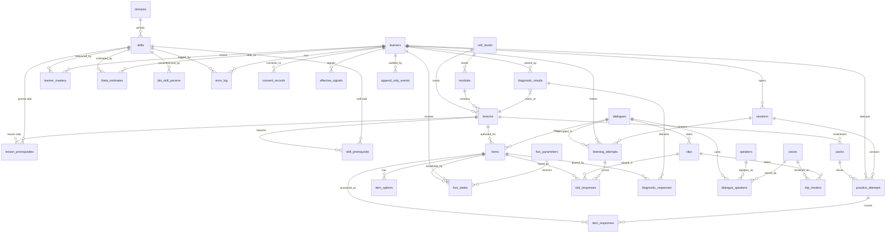

# ITS Platform — Data Model (ERD) v1.0.0 — derived from the specs

> **Status: Derived — the persistence contract for P0.3.**
> Derived 2026-10-05 under `BACKLOG.md` **P0.3a**. Acceptance criterion: the sixteen
> corrections of [ADR-018](../adr/018-persistence-derived-from-specs.md) §9, each naming its
> spec `§` (§2 below is that ledger). Supersedes `v0.1.0-draft`, which declared
> `ITS-ARCHITECTURE.md §7` — a twenty-line *sketch* — as its source and was superseded by
> ADR-018 on 2026-10-05.

---

## 0. Source and authority

This model is derived from six specs and four ADRs. **Every column below names its `§`.**
A column with no citation is a defect in this document.

| Source | Role |
|---|---|
| `specs/assessment-item-spec.md` | item schema (§1), distractor taxonomy (§2), calibration (§3), quality (§5), lifecycle (§7) |
| `specs/post-lesson-practice-spec.md` | three practice layers (§1–§4), FSRS grading (§3.2/§3.3), pack manifest (§8.1) |
| `specs/stats-progress-evaluation-spec.md` | BKT (§2), mastery rules (§3), IRT bank (§4), FSRS-4.5 (§6), event log (§9.1) |
| `specs/diagnostic-spec.md` | CAT output (§3.6), dimensionality lattice (§3.3a) |
| `specs/curriculum-graph-spec.md` | node/edge types (§1), modules (§3), gate predicate (§6.1), decay (§7.2) |
| `specs/listening-corpus-spec.md` | voice control (§2.1), rate (§2.2), L1/L2 tiers (§2.3), item types (§4) |
| ADR-003 / ADR-014 | RLS predicate and `SET LOCAL` wrapper; PGlite vs real PostgreSQL |
| ADR-015 / ADR-016 / ADR-017 | bounded contexts, identifier ledger, fixed-form diagnostic + ordinal routing |
| ADR-018 | **the 16 corrections (§9), the invariant floor (§1), folds 3–7** |
| `docs/domain-model.md` | aggregate invariants with their **[domain]** / **[db]** placement (§3), entities (§4), state vocabularies (§6) |

**Not a source:** `ITS-ARCHITECTURE.md §7` (sketch — see ADR-018 Context).

---

## 1. Bounded contexts → tables (ADR-015 §1)

| # | Context | Aggregate root | Tables |
|---|---|---|---|
| 1 | Curriculum Catalog | `CurriculumGraph` | `cefr_levels`, `domains`, `skills`, `modules`, `lessons`, `lesson_prerequisites`, `skill_prerequisite` |
| 2 | Item Bank | `AssessmentItem` | `items`, `item_options`, `packs` |
| 3 | Listening Corpus | `Dialogue` | `dialogues`, `speakers`, `dialogue_speakers`, `voices`, `clips`, `clip_renders` |
| 4 | Learner Model | `LearnerModel` | `learners`, `learner_mastery`, `theta_estimates`, `fsrs_states`, `error_log`, `affective_signals` |
| 5 | Delivery | `LearningSession` | `sessions`, `practice_attempts`, `item_responses`, `listening_attempts`, `slot_responses` |
| 6 | Diagnostic / Placement | `DiagnosticRun` | `diagnostic_results`, `diagnostic_responses` |
| 7 | Selection & Scheduling | *stateless policy* | none — a pure function of contexts 1, 2, 4 |
| 8 | Identity & Compliance | `LearnerAccount`, `ConsentRecord`, `AppendOnlyEvent` | `consent_records`, `append_only_events` |
| — | Shared statistics (refit targets) | *owned by context 4* | `fsrs_parameters`, `bkt_skill_params` |

---

## 2. Acceptance ledger — the sixteen corrections of ADR-018 §9

Each row is one correction of §9, showing where it landed in this document.

| # | Artefact | Change applied — where it now lives | Source of the requirement |
|---:|---|---|---|
| 1 | `items` | `skill_id` FK → **`items.skill_ids TEXT[]`** + GIN index `idx_items_skill_ids` (§6.3) | `assessment` §1 |
| 2 | `items` | Full calibration + quality + provenance + assets + metadata layer added: `a, b, a_se, b_se, n_responses, calibration_status, anchored_by, last_refit, infit_mnsq, outfit_mnsq, point_biserial, difficulty_p, dif_flags, p_random, retired, retired_reason, provenance_kind, provenance_source_file, provenance_source_locator, reviewed_by, tts_required, review_due` — plus `c`, `irt_model` from §1's own example. `(a,b)` now has columns for P1.8's output | `assessment` §1, §3, §5, §7 |
| 3 | `items` | `item_type` CHECK → the specs' closed vocabulary: `gap_fill, error_correction, form_selection, definition_match, register_selection, scanning, cloze, matching, ordering, contextual_selection, minimal_pair, production`. The v0.1.0 values (`mcq, production, minimal_pair`) intersect none of it | `assessment` §1, §2.3 |
| 4 | `listening_distractors` | `distractor_type` CHECK → the six real types `l1_transfer, overgeneralization, semantic_plausible, form_alternative, register_mismatch, negative_control`, now on the unified `item_options` (the table `listening_distractors` was folded by correction 6). The v0.1.0 four values were invented; `l1_transfer` — §2.1's *"highest-value distractor in the whole bank"* — was uninsertable | `assessment` §2.1 |
| 5 | `fsrs_states` | `retrievability` **deleted**; `w_version` (+ `fsrs_parameters` as its FK target), `grade`, `state`, `hint_used` added; `due_date` kept as versioned index projection (ADR-018 §3) | `stats` §6.1, §6.2a; `post-lesson` §3.2/§3.3 |
| 6 | `listening_items` | Folded into **`items`** as a subtype: `modality='listening'` + nullable `dialogue_id`, `slot_number`, `clip_ids`, `listening_kind`, `listening_tier`. One item table → one FSRS FK across all five domains; `slot_responses.listening_item_id` now references `items.id` | `post-lesson` §3.4, §7; ADR-018 §5 |
| 7 | `item_responses` | **`bkt_transition` and its CHECK deleted.** `learned/retained/forgot/guessed` appears in no spec and is not recoverable from a binary outcome; `confidence` stays as the learner's honest signal | absence across all 6 specs; ADR-018 §9.7 |
| 8 | `mastery` → `learner_mastery` | Renamed (current state, not history — history is the append-only event log). Columns `n_obs`, `distinct_days`, `spaced_obs` added; **`gate_passed` and its trigger deleted** | invariant floor, ADR-018 §1–§2; `domain-model` L-1/L-2 |
| 9 | `learners` | `cefr_level` **deleted.** Current placement = latest completed `diagnostic_results` row, read at query time — a projection carries its provenance; a mutable column did not | ADR-017 §3 |
| 10 | `learners` | `streak_days`, `xp` **deleted** — no spec defines a badge, threshold, award or revocation | ADR-015 §3 |
| 11 | `learners` | `consent_given_at`, `consent_version` **deleted**; append-only **`consent_records(learner_id, purpose, version, granted_at, withdrawn_at, legal_basis)`** added | `CONSTITUTION` §8.1; LGPD Art. 8; `domain-model` X-1 |
| 12 | `lessons` | `status` split into **`authoring_state`** + **`publication_state`** + **`permission_state`** (three questions, three closed vocabularies); **`skill_prerequisite(lesson_id, skill_id, weight)`** join added, migrated out of lesson-file JSON | ADR-018 §6; `external-sources` §7.0; ADR-015 §4; `domain-model` §4.2 |
| 13 | `dialogues` | **`speakers`, `dialogue_speakers`, `clips`, `clip_renders`** added — the take entity implied by `v_take_03` and by DEF-13's remedy *"a second render on panel voices"*; `dialogue_voices` folded into `dialogue_speakers` | `listening-corpus` §2.1, §2.3; `domain-model` §4.4 |
| 14 | `slot_responses` | **`voice_id`, `clip_id`, `assist_used`, `replays`** added (plus `learner_id` for correction 16's RLS). Without them the Control-1 voice-balance analysis and the accommodation-vs-ability separation are impossible | `listening-corpus` §2.1 (*"Record `voice_id` and `dialogue_id` on every response"*), §2.2 |
| 15 | `diagnostic_results` | **`form_version`, `start_cefr`, `below_scale`, `remediation_nodes TEXT[]` (≤3), `bkt_priors_override JSONB`, `skill_theta JSONB`** with §3.3a's three-state lattice under an explicit `state` discriminator; `se_statistical/se_parameter/se_effective/precision_label` from §3.6's disclosure; **`blueprint_coverage` deleted** — defined in no spec, and under the fixed form coverage is a property of `form_version` | `diagnostic` §3.6, §3.3a; ADR-017 §3, `domain-model` G-1/G-6/G-8 |
| 16 | all learner-scoped tables | **RLS policies + `SET LOCAL` wrapper** — 15 learner-scoped tables enumerated in §9 with the `ADR-003` predicate. 0 policies exist today against an `Accepted` ADR and a `CONSTITUTION` §2 principle | ADR-003; `BACKLOG` P2.1; `domain-model` X-4 |

---

## 3. Derivations beyond the sixteen (each with its `§`)

These are not corrections of §9; they are required to make the model derivable from the
specs at all. Each names the rule that forces it.

| Decision | Why, and from where |
|---|---|
| `item_options` stays **relational** (not folded into `items` as JSONB) | ADR-018 Neutral gives the fold criterion: write-once *unless DIF analysis needs to query it*. `assessment` §5.3 (distractor analysis at refit), §5.4 (DIF) and §2.2 (key-position balance ≤40 %) are all per-option queries — the second branch of the criterion applies |
| `packs.item_ids TEXT[]` + `packs.manifest JSONB` — **no `pack_items` table** | The manifest is write-once authored content (`post-lesson` §8.1), which is the first branch of the same fold criterion. Array order = manifest order; referential integrity of `item_ids` is the P0.5 loader gate, not an FK |
| `lessons.body` **JSONB** (the four `FASE` blocks + learner model) — **no `lesson_phases` table** | The same fold criterion as `packs.manifest` above: the four blocks are write-once authored content, read whole by one endpoint and never queried per phase. `domain-model` §2.1 already assigns them — *"ACL: ContentLoader — FASE 1–4 blocks → internal model"* — and ADR-027 §5 materialises the assignment: the API's `LessonContent.required` (`api-spec.openapi.yaml`, amended by ADR-027 §4) names `phases[]` + `learner_model`, and the content carries them — measured 122/122 lessons with four `FASE` headings, 121/122 with the learner-model block |
| `dialogues.transcript` **TEXT** | ADR-027 §3b. `listening-corpus` §2.1 authors one transcript per dialogue, and `clips` are **derived** from it (`clips.utterance_text` keeps a single turn and drops the speaker's name). The API's `DialogueContent.slots[].transcript` is required and no column answered it, so the source is stored instead of the derived rows being re-joined. Same fold criterion as `packs.manifest`: read whole, never queried per turn |
| `practice_attempts.pack_layer` + nullable `pack_id` | ADR-018 *"What weakens"* row 4: L2/L3 packs are generated per learner (`post-lesson` §3.4 resampling, §4.2 error-log query) and have no stored pack row. `CHECK ((pack_layer='L1') = (pack_id IS NOT NULL))` |
| `items.pack_id` **removed** | `assessment` §1.2: *"Pack-slot placement belongs in the pack manifest."* v0.1.0 made every item a child of one pack |
| `cefr_levels.theta_threshold` (nullable) | `stats` §3.1 gives θ* only for A2 (−0.5), B1 (0.5), B2 (1.5); ADR-017 §3's `band_bounds` routing reads it. A1/C1/C2 are unspecified in every spec → `NULL`, never invented (§10) |
| `append_only_events` | `stats` §9.1's 18-field append-only event promoted by ADR-015 §5 to a first-class table; required by `assessment` §7 (a retired item *"remains queryable"*), hash chain per `CONSTITUTION` §4.6 |
| `error_log`, `affective_signals` | ADR-015 §4 / `domain-model` §4.1, §4.3 — entities the specs name as inputs (`post-lesson` §4.2 ranks the error log; `curriculum-graph` §11 takes affective state) and did not have |
| `fsrs_parameters`, `bkt_skill_params` | `w_version` (correction 5) needs an FK target; `stats` §6.2a refits `w` at 512 pooled reviews. `stats` §2.1's anchors are *"judgement anchors, to be fitted"* and §9.2's nightly job outputs per-skill parameters |
| `learner_id` on `item_responses`, `slot_responses`, `diagnostic_responses` | ADR-003's policy predicate is a **direct column comparison** (`learner_id = current_setting(...)::uuid`). A policy that must traverse three FK levels per row would make RLS the slowest part of every read |
| `items.answer_variants TEXT[]` | `assessment` §2.3: free-text variants are *"enumerated per item, not inferred"*, and an item with unenumerated variants must not enter the CAT |
| `items.scoring` | `assessment` §2.2.1: production items carry `scoring: asr_phoneme_match` *instead of* a key |
| `items.listening_kind`, `items.listening_tier` | `listening-corpus` §4's six types (`lst_gist` … `lst_pron_minpair`) are a vocabulary in their own right; keeping them out of `item_type` satisfies correction 3's closed 12-value CHECK *and* §4 literally. The L1/L2 tier (§2.3) gates CAT admission and ear-check obligations |
| `domains.tracked = false` for `coherence` + `CHECK (domain_id <> 'coherence')` on `items` | `assessment` §1.2: coherence is a *skill namespace*, not a sixth tracked domain; a `coh_` item is weighted by its declared tracked domain |
| `theta_estimates` unchanged | Not among the 16; v0.1.0 shape retained. Its `ci95_*` is an interval on θ — a different quantity from `CI₉₅(P(mastery))` (ADR-018 §2). Listening rows never exist (`domain-model` L-8) |
| `sessions`: `device_type`/`is_offline` dropped | No spec reads them (§0's rule: a column without a citation is a defect) |

---

## 4. Table count reconciliation (28 → 33)

ADR-018 Neutral estimated *"22–26 tables"*. The derived model has **33**. The estimate did
not count its own correction 13 (four tables), ADR-015 §4/§5's declared entities, or the
`w_version` FK target. Every ±1:

| Step | Δ | Tables |
|---|---:|---|
| v0.1.0-draft baseline | 28 | — |
| Delete `content_embeddings` (pgvector) | −1 | ADR-018 §8 |
| Delete `learner_preferences` | −1 | ADR-018 Neutral (folded into `consent_records`) |
| `options` + `listening_distractors` → `item_options` | −1 | fold of corrections 4 + 6 |
| `listening_items` → `items` | −1 | correction 6 |
| `dialogue_voices` → `dialogue_speakers` | −1 | correction 13 |
| `consent_records` | +1 | correction 11 |
| `speakers`, `dialogue_speakers`, `clips`, `clip_renders` | +4 | correction 13 |
| `fsrs_parameters` | +1 | correction 5's FK target |
| `error_log`, `affective_signals`, `append_only_events` | +3 | ADR-015 §4/§5 |
| `bkt_skill_params` | +1 | `stats` §2.1, §9.2 |
| **Derived total** | **33** | rename only: `mastery`→`learner_mastery`, `skill_prerequisites`→`skill_prerequisite` (reshaped) |

---

## 5. Diagram



> Columns are in §6; the diagram carries structure only.

---

## 6. DDL

Creation order below is FK-dependency order. PostgreSQL 16. `UUID` via `pgcrypto`
(`gen_random_uuid()`), all timestamps `TIMESTAMPTZ` (ADR-014: identical on PGlite and
PostgreSQL), structured columns `JSONB`. Where `docs/domain-model.md` §3 marks an invariant
**[db]**, the constraint is inline in the column it constrains — the old standalone
*Invariants* section is not ported (ADR-018 implementation plan).

### 6.1 Reference & Curriculum Catalog (context 1)

```sql
-- CEFR levels — curriculum-graph §2 (band sequence).
CREATE TABLE cefr_levels (
    code            VARCHAR(3) PRIMARY KEY CHECK (code ~ '^(A|B|C)[12]$'),
    label           VARCHAR(50) NOT NULL,
    sort_order      INT NOT NULL UNIQUE,
    -- stats §3.1: θ*_CEFR given for A2 (−0.5), B1 (0.5), B2 (1.5) only.
    -- ADR-017 §3 band_bounds routing reads this column. A1/C1/C2 thresholds are
    -- unspecified in every spec → NULL, never invented (see §10).
    theta_threshold NUMERIC(4,2)
);

-- assessment §1.2: five tracked domains for weighting; coherence is a skill
-- namespace, not a sixth tracked domain.
CREATE TABLE domains (
    id      VARCHAR(20) PRIMARY KEY,  -- grammar | vocab | reading | pronunciation | listening | coherence
    label   VARCHAR(50) NOT NULL,
    tracked BOOLEAN NOT NULL DEFAULT true  -- coherence = false (assessment §1.2)
);

-- ADR-016 identifier ledger: canonical <domain>.<slug>; aliases resolved at load.
CREATE TABLE skills (
    id          VARCHAR(50) PRIMARY KEY,   -- grammar.be_affirmative
    domain_id   VARCHAR(20) NOT NULL REFERENCES domains(id),
    label       VARCHAR(100) NOT NULL,
    description TEXT
);

-- curriculum-graph §3: ID, Title, CEFR, Source Markdown(s), Track, Lessons.
CREATE TABLE modules (
    id               VARCHAR(50) PRIMARY KEY,   -- mod_a1_foundation
    title            VARCHAR(200) NOT NULL,
    cefr_level       VARCHAR(3) NOT NULL REFERENCES cefr_levels(code),
    track            VARCHAR(10) NOT NULL CHECK (track IN ('General','IT','Both')),  -- §3
    source_markdowns TEXT[] NOT NULL,           -- §3 "Source Markdown(s)"
    sort_order       INT NOT NULL,
    expected_lessons INT NOT NULL,              -- §2: 6 / 10 / 8 per module
    UNIQUE (track, cefr_level, sort_order)
);

-- correction 12: one `status` split into three questions.
CREATE TABLE lessons (
    id                VARCHAR(50) PRIMARY KEY,  -- les_a2_greetings_intro
    module_id         VARCHAR(50) NOT NULL REFERENCES modules(id),
    title             VARCHAR(200) NOT NULL,
    cefr_level        VARCHAR(3) NOT NULL REFERENCES cefr_levels(code),
    reuse_basis       VARCHAR(30) NOT NULL
        CHECK (reuse_basis IN ('cite_only','adapt_with_attribution','adapt_requires_permission')),
                      -- external-sources §0.5 / §7.0; enforced by verify-integrity [8]
    authoring_state   VARCHAR(20) NOT NULL
        CHECK (authoring_state IN ('authored','specified','unauthored','blocked','withdrawn')),
                      -- SDD §4 status vocabulary
    publication_state VARCHAR(32) NOT NULL
        CHECK (publication_state IN ('publishable','restricted_pending_permission','not_publishable')),
                      -- external-sources §7.0 (what may be published)
    permission_state  VARCHAR(20) NOT NULL
        CHECK (permission_state IN ('not_required','requested','granted','refused')),
                      -- external-sources §7.0 (permission-request lifecycle); ADR-018 §6
    source_ref        TEXT,
    -- ADR-027 §5: the lesson's four authored `FASE` blocks, verbatim, plus its parsed
    -- learner-model JSON (`null` for the one lesson whose file has none). ADR-018 §1's
    -- fold criterion: read whole by one endpoint, never queried per phase.
    body              JSONB NOT NULL DEFAULT '{"phases":[],"learner_model":null}',
    created_at        TIMESTAMPTZ NOT NULL DEFAULT now(),
    updated_at        TIMESTAMPTZ NOT NULL DEFAULT now()
);

-- curriculum-graph §1.2: four lesson-level edge types. Module Sequence (§1.2) is
-- encoded by modules.sort_order within track; it has no row here.
CREATE TABLE lesson_prerequisites (
    lesson_id VARCHAR(50) NOT NULL REFERENCES lessons(id) ON DELETE CASCADE,
    prereq_id VARCHAR(50) NOT NULL REFERENCES lessons(id) ON DELETE CASCADE,
    edge_type VARCHAR(20) NOT NULL DEFAULT 'prerequisite'
        CHECK (edge_type IN ('prerequisite','alternative_path','remediation','enrichment')),
    PRIMARY KEY (lesson_id, prereq_id),
    CHECK (lesson_id <> prereq_id)
);
-- Acyclicity is [domain] (domain-model C-1, topological_sort at load), not a DB constraint.

-- correction 12 + ADR-015 §4 + domain-model §4.2: the lesson's required-skill set,
-- migrated out of lesson-file JSON where curriculum-graph §6.1's gate reads it.
CREATE TABLE skill_prerequisite (
    lesson_id VARCHAR(50) NOT NULL REFERENCES lessons(id) ON DELETE CASCADE,
    skill_id  VARCHAR(50) NOT NULL REFERENCES skills(id),
    weight    NUMERIC(4,3) NOT NULL DEFAULT 1.000,  -- ADR-015 §4 shape (lesson_id, skill_id, weight)
    PRIMARY KEY (lesson_id, skill_id)
);
-- Replaces v0.1.0's skill_prerequisites (skill→skill): no predicate read it, while the
-- §6.1 gate "∀ skill ∈ prereq_skills(les_B)" had no table at all.

-- post-lesson §8.1 (manifest), §12 (two schemas), §1 (three layers).
CREATE TABLE packs (
    id             VARCHAR(100) PRIMARY KEY,  -- pack_les_a2_greetings_intro_v1
    lesson_id      VARCHAR(50) NOT NULL REFERENCES lessons(id),
    schema_version VARCHAR(20) NOT NULL CHECK (schema_version IN ('canonical','legacy_v1')),
                                                                 -- post-lesson §12.1; ADR-004
    reuse_basis    VARCHAR(30) NOT NULL
        CHECK (reuse_basis IN ('cite_only','adapt_with_attribution','adapt_requires_permission')),
    manifest       JSONB NOT NULL,   -- §8.1 pack manifest verbatim (write-once content)
    item_ids       TEXT[] NOT NULL,  -- ordered projection of manifest items; GIN-indexed.
                                                                 -- referential integrity = P0.5 loader gate, not an FK
    created_at     TIMESTAMPTZ NOT NULL DEFAULT now()
);
-- L2/L3 packs are generated per learner at runtime (§3.4 resampling, §4.2 error-log
-- query) and have no row here. Pack size has no CHECK: three layers, three size rules,
-- all domain construction (ADR-018 §7; old invariant 4 deleted).
```

### 6.2 Listening Corpus (context 3)

```sql
-- listening-corpus §2.1: a panel of ≥4 distinct voices; voice is a blocking variable.
CREATE TABLE voices (
    id      VARCHAR(20) PRIMARY KEY,  -- v_a | v_b | v_c | v_d
    label   VARCHAR(50) NOT NULL,
    accent  VARCHAR(50) NOT NULL,
    gender  VARCHAR(10),
    active  BOOLEAN NOT NULL DEFAULT true
);
-- v0.1.0 voices.speaker_name moved to speakers.name (correction 13).

-- correction 13; domain-model §4.4: "Speaker is load-bearing and was undefined".
CREATE TABLE speakers (
    id           VARCHAR(50) PRIMARY KEY,
    display_name VARCHAR(100) NOT NULL,
    gender       VARCHAR(10)
);

CREATE TABLE dialogues (
    id               VARCHAR(50) PRIMARY KEY,  -- dlg_a2_01_small_talk (ADR-016 ledger)
    title            VARCHAR(200) NOT NULL,
    cefr_level       VARCHAR(3) NOT NULL REFERENCES cefr_levels(code),
    -- correction 6 vocabulary: ADR-018 §6, listening-corpus §5. "Withdrawn" is not a
    -- dialogue status — a withdrawn dialogue's items are retired (items.retired), and the
    -- dialogue stays queryable (assessment §7).
    status           VARCHAR(20) NOT NULL CHECK (status IN ('shipped','shadow_only')),
    -- domain-model D-2 [db]: 45–120 s (Q-L2 floor 45 s; §2.1 120 s ceiling).
    duration_seconds INT NOT NULL CHECK (duration_seconds BETWEEN 45 AND 120),
    -- ADR-027 §3b: the dialogue's authored `> **Speaker:** …` transcript, verbatim. It is the
    -- source `clips` are derived from (each clip keeps only one turn's text + its speaker), so
    -- it is stored rather than re-joined from them. `DialogueContent.slots[].transcript`
    -- serves it; a per-slot slice would need a slot↔clip link, which does not exist
    -- (`items.clip_ids` is never populated).
    transcript       TEXT NOT NULL,
    created_at       TIMESTAMPTZ NOT NULL DEFAULT now()
);

-- correction 13; replaces dialogue_voices (fold recorded in §4).
CREATE TABLE dialogue_speakers (
    dialogue_id VARCHAR(50) NOT NULL REFERENCES dialogues(id) ON DELETE CASCADE,
    speaker_id  VARCHAR(50) NOT NULL REFERENCES speakers(id),
    -- domain-model D-12 [db] + §2.1 Amendment: within a dialogue, voice ≡ speaker identity.
    voice_id    VARCHAR(20) NOT NULL REFERENCES voices(id),
    PRIMARY KEY (dialogue_id, speaker_id),
    UNIQUE (dialogue_id, voice_id)
);
-- D-5 [db]: ≥2 speakers for conversational register — cannot be an inline CHECK
-- (cross-row); enforced by a deferred trigger in the P0.4 migration (§10).

-- listening-corpus §2.3 (transcript, phonetic transcription), Q-L9 (transcript matches audio).
CREATE TABLE clips (
    id              VARCHAR(60) PRIMARY KEY,  -- clip_dlg_a2_01_small_talk_001 (ADR-016 ledger)
    dialogue_id     VARCHAR(50) NOT NULL REFERENCES dialogues(id) ON DELETE CASCADE,
    speaker_id      VARCHAR(50) NOT NULL REFERENCES speakers(id),
    sort_index      SMALLINT NOT NULL,
    utterance_text  TEXT NOT NULL,             -- domain-model D-9: the utterance this clip says
    phonetic_target TEXT,                      -- §2.3(2): phonetic transcription recorded with the clip
    UNIQUE (dialogue_id, sort_index)
);

-- correction 13: the take entity implied by v_take_03; domain-model §4.4.
-- clip_renders(dialogue, clip, take, voice_id, rate, duration_s, uri, ear_checked_at).
CREATE TABLE clip_renders (
    id             BIGSERIAL PRIMARY KEY,
    clip_id        VARCHAR(60) NOT NULL REFERENCES clips(id) ON DELETE CASCADE,
    take           SMALLINT NOT NULL,          -- DEF-13 remedy: a second render on panel voices
    voice_id       VARCHAR(20) NOT NULL REFERENCES voices(id),
    -- content-map §11 Decision #3 / listening-corpus §2.2: 1.0× canonical, 0.75× on demand.
    rate           NUMERIC(3,2) NOT NULL DEFAULT 1.00 CHECK (rate IN (1.00, 0.75)),
    duration_s     NUMERIC(5,2) NOT NULL,
    uri            TEXT NOT NULL,
    ear_checked_at TIMESTAMPTZ,                 -- D-7: per-clip ear check, 100% of L2 clips (§2.3)
    ear_checked_by TEXT,
    UNIQUE (clip_id, take)
);
```

### 6.3 Item Bank (context 2)

```sql
CREATE TABLE items (
    id             VARCHAR(100) PRIMARY KEY,   -- grm_demonstrative_this_001 (ADR-016 ledger);
                                               -- immutable, never reused (assessment §1.2, I-2)
    schema_version VARCHAR(10) NOT NULL DEFAULT '2.0',  -- assessment §1

    -- correction 1: skill_ids[] replaces the single skill_id FK.
    skill_ids      TEXT[] NOT NULL,            -- assessment §1
    lesson_id      VARCHAR(50) REFERENCES lessons(id),  -- §1; NULL for corpus-only items
    dialogue_id    VARCHAR(50) REFERENCES dialogues(id),  -- correction 6: listening subtype
    slot_number    SMALLINT,                   -- v0.1.0 listening_items.slot_number
    -- clips played for this slot: listening-corpus §4 Amendment (B1 items need two-turn context)
    clip_ids       TEXT[],

    cefr_level     VARCHAR(3) NOT NULL REFERENCES cefr_levels(code),
    domain_id      VARCHAR(20) NOT NULL REFERENCES domains(id),
    -- assessment §1.2: coherence is a skill namespace, not a tracked domain; a coh_ item
    -- is weighted by its declared tracked domain and occupies one of the five slots.
    CHECK (domain_id <> 'coherence'),

    -- correction 3: the specs' closed vocabulary (gap_fill … production).
    item_type      VARCHAR(25) NOT NULL
        CHECK (item_type IN ('gap_fill','error_correction','form_selection','definition_match',
                             'register_selection','scanning','cloze','matching','ordering',
                             'contextual_selection','minimal_pair','production')),
    -- listening-corpus §4's six types, kept out of item_type so both vocabularies stay
    -- literal (§3): lst_gist … lst_pron_minpair.
    listening_kind VARCHAR(20)
        CHECK (listening_kind IN ('lst_gist','lst_detail','lst_inference','lst_lexical',
                                  'lst_pragmatic','lst_pron_minpair')),
    -- §2.3: L2 items are specified but gated (ear check before any CAT admission).
    listening_tier CHAR(2) CHECK (listening_tier IN ('L1','L2')),
    -- correction 6 discriminator: `modality='listening'` marks the folded subtype.
    modality       VARCHAR(10) NOT NULL CHECK (modality IN ('text','listening','speaking')),
                       -- 'text': assessment §1; 'listening': correction 6;
                       -- 'speaking': post-lesson §2.3 production items scored by ASR
    -- assessment §2.2.1 / §2.3: production items carry scoring instead of a key.
    scoring        VARCHAR(25) NOT NULL DEFAULT 'choice'
        CHECK (scoring IN ('choice','free_text','asr_phoneme_match')),

    stem           TEXT NOT NULL,              -- assessment §1
    key            TEXT,                        -- §1; NULL for asr_phoneme_match (§2.2.1)
    -- §2.3: free-text variants enumerated per item, never inferred; an item with
    -- unenumerated variants must not enter the CAT.
    answer_variants TEXT[],
    -- §1.1: 1/n MCQ; 1/n! matching & ordering (§2.3). BKT P(G) = p_random per item
    -- (stats §2.1 correction X7) — P(G) has no column of its own.
    p_random       NUMERIC(5,4) NOT NULL CHECK (p_random > 0 AND p_random <= 1),
    br_pt_tags     TEXT[],                      -- assessment §1
    -- assessment §2.2.1: the third state is per-ITEM (the item has no distractor set at all).
    br_pt_form_state VARCHAR(40) NOT NULL DEFAULT 'applicable'
        CHECK (br_pt_form_state IN ('applicable','not_applicable_no_distractor_set')),

    -- correction 2 — calibration layer: P1.8's output had no column anywhere.
    irt_model      VARCHAR(5) NOT NULL DEFAULT '2PL',   -- stats §4.1
    a              NUMERIC(6,4),                -- assessment §3: discrimination ≥1.2 for CAT
    b              NUMERIC(7,4),                -- assessment §3.4: difficulty within (−3, 3)
    c              NUMERIC(5,4) NOT NULL DEFAULT 0.0000,  -- §1 example (3PL guessing param)
    a_se           NUMERIC(6,4),                -- §3.3: inflated while uncalibrated
    b_se           NUMERIC(6,4),
    n_responses    INT NOT NULL DEFAULT 0,
    -- stats §4.4 three statuses; NULL = not yet anchored (lifecycle < expert_anchored, §7).
    calibration_status VARCHAR(25)
        CHECK (calibration_status IN ('expert_anchored','partially_calibrated','empirically_calibrated')),
    anchored_by    TEXT[],                      -- §1: stage-1 anchors
    last_refit     TIMESTAMPTZ,                 -- §3.2 two-stage protocol

    -- correction 2 — quality layer (§5.2 fit criteria).
    infit_mnsq     NUMERIC(5,3),                -- ∈ [0.7, 1.3]
    outfit_mnsq    NUMERIC(5,3),
    point_biserial NUMERIC(5,3),                -- ≥ 0.20 (§5.2)
    difficulty_p   NUMERIC(5,3),                -- §3.4: 0.30–0.70 at item level
    dif_flags      JSONB NOT NULL DEFAULT '[]', -- §5.4: A-class (−0.65), B-class (±0.45)
    -- assessment §7 / ADR-018 §6: pulled by defect, retained, never served again.
    retired        BOOLEAN NOT NULL DEFAULT false,
    retired_reason TEXT,
    -- assessment §7 lifecycle; domain-model §6 vocabulary.
    lifecycle_state VARCHAR(25) NOT NULL DEFAULT 'authored'
        CHECK (lifecycle_state IN ('authored','drafted','peer_reviewed','expert_anchored',
                                   'partially_calibrated','empirically_calibrated','serving',
                                   'rejected','revision','retired')),
    -- `retired` ⇔ lifecycle_state='retired' kept consistent by the domain layer (I-1 [domain]).

    -- correction 2 — provenance & review.
    provenance_kind VARCHAR(30) NOT NULL
        CHECK (provenance_kind IN ('source_derived','authored','authored_reviewed_corpus')),
                                        -- assessment §1; listening-corpus §2.4
    provenance_source_file   TEXT,       -- §1: permanent trace (verify-integrity [8] reads it)
    provenance_source_locator TEXT,
    reviewed_by  TEXT,                   -- §1.1/§5.1 (G-Q7): required before CAT admission
    review_due   DATE,                   -- §7.1: auto-retire 180 days past review_due (I-9)

    -- correction 2 — assets & metadata.
    tts_required        BOOLEAN NOT NULL DEFAULT false,   -- §1: listen-first, no transcript-before-audio
    tts_refs            TEXT[] NOT NULL DEFAULT '{}',     -- §1 assets.tts_refs
    assist_tts_refs     TEXT[] NOT NULL DEFAULT '{}',     -- §1 assets.assist_tts_refs; 0.75×
                                                          -- "à brasileira", never auto-played
                                                          -- (content-map §11 #3)
    estimated_time_sec  INT,               -- §1 metadata
    authored_at         TIMESTAMPTZ,       -- §1 metadata
    created_at          TIMESTAMPTZ NOT NULL DEFAULT now(),
    updated_at          TIMESTAMPTZ NOT NULL DEFAULT now(),

    CHECK (listening_kind IS NULL OR modality = 'listening'),
    CHECK (listening_tier IS NULL OR modality = 'listening')
);
-- [db] I-2 (domain-model §3.2): no UPDATE/DELETE grant on items — identifiers immutable.
-- [db] I-3: partial unique index below (≤1 key); "exactly one key" and option-text
--   distinctness are [domain] plus a normalization trigger (P0.4, §10).
-- items.pack_id removed: pack-slot placement lives in the pack manifest (assessment §1.2).

-- Replaces BOTH v0.1.0 `options` and `listening_distractors` (folds 4 + 6).
-- Kept relational, not JSONB: §5.3 (distractor analysis), §5.4 (DIF) and §2.2
-- (key-position balance) are per-option queries — ADR-018 fold criterion, second branch.
CREATE TABLE item_options (
    id           BIGSERIAL PRIMARY KEY,
    item_id      VARCHAR(100) NOT NULL REFERENCES items(id) ON DELETE CASCADE,
    position     SMALLINT NOT NULL CHECK (position BETWEEN 1 AND 6),
                                                   -- letter A–D is presentation of position
    option_text  TEXT NOT NULL,
    is_key       BOOLEAN NOT NULL DEFAULT false,   -- assessment §1 "key"
    -- correction 4: the six real types; the v0.1.0 four were invented and l1_transfer —
    -- §2.1's highest-value distractor — was uninsertable.
    distractor_type VARCHAR(25)
        CHECK (distractor_type IN ('l1_transfer','overgeneralization','semantic_plausible',
                                   'form_alternative','register_mismatch','negative_control')),
    br_pt_form   TEXT,      -- §2.2.1: the Portuguese form that generates the error
    note         TEXT,      -- §2.2.1 / verify-integrity [9]: every distractor carries a
                           --   note, filled or null; rationale for key rows is optional
    CHECK (is_key OR note IS NOT NULL),
    expected_share NUMERIC(4,3),  -- §1: predicted choice share, validated at refit (§5.3)
    UNIQUE (item_id, position)
);
-- ≤1 key per item (I-3's [db] half; "exactly" is [domain]).
CREATE UNIQUE INDEX uq_item_options_one_key ON item_options(item_id) WHERE is_key;
-- I-3 distinctness ([db]) needs case/bold normalization → trigger in the P0.4 migration.
```

### 6.4 Statistics & refit targets (owned by context 4)

```sql
-- correction 5's FK target: w_version needs somewhere to point. stats §6.1: exactly 21
-- weights, order load-bearing; §6.2a refits at 512 pooled reviews → a new row, never a
-- silent edit (derived values are versioned with the vector that produced them).
CREATE TABLE fsrs_parameters (
    w_version   VARCHAR(40) PRIMARY KEY,  -- 'fsrs-4.5-default' | 'fit-<YYYYMMDD>'
    w           JSONB NOT NULL CHECK (jsonb_array_length(w) = 21),  -- stats §6.1
    -- derived from w at insert (domain/loader), stored like due_date: derived + versioned.
    decay       NUMERIC(6,4) NOT NULL,    -- DECAY = −w[20]   (0.1542)
    factor      NUMERIC(6,4) NOT NULL,    -- FACTOR = 0.9^(1/DECAY) − 1 (0.9803)
    n_reviews   INT NOT NULL DEFAULT 0,   -- stats §6.2a: refit threshold evidence
    fitted_at   TIMESTAMPTZ,
    is_active   BOOLEAN NOT NULL DEFAULT false  -- one global w in effect
);

-- stats §2.1 (judgement anchors to be fitted), §9.2 (nightly BKT refit output).
CREATE TABLE bkt_skill_params (
    skill_id      VARCHAR(50) PRIMARY KEY REFERENCES skills(id),
    p_l0          NUMERIC(4,3) NOT NULL DEFAULT 0.15,  -- false-beginner bias (§2.1)
    p_t           NUMERIC(4,3) NOT NULL DEFAULT 0.25,
    p_s           NUMERIC(4,3) NOT NULL DEFAULT 0.10,
    source        VARCHAR(20) NOT NULL CHECK (source IN ('judgement_anchor','fitted')),
                                                   -- §2.1: relabel once refitted
    fitted_at     TIMESTAMPTZ,
    model_version VARCHAR(30)
);
-- P(G) is deliberately absent: P(G)_item = items.p_random, per item (§2.1 correction X7).
```

### 6.5 Learner Model & Compliance (contexts 4, 8)

```sql
CREATE TABLE learners (
    id             UUID PRIMARY KEY DEFAULT gen_random_uuid(),
    created_at     TIMESTAMPTZ NOT NULL DEFAULT now(),
    last_active_at TIMESTAMPTZ,
    updated_at     TIMESTAMPTZ NOT NULL DEFAULT now()
);
-- corrections 9/10/11 removed: cefr_level, streak_days, xp, consent_given_at, consent_version.
-- Current CEFR = latest completed diagnostic_results.cefr, read at query time — a projection
-- would carry derived_from_diagnostic_id + as_of; a mutable column had neither (ADR-017 §3).
-- Gamification has no persistence at all (ADR-015 §3): no spec defines a badge, threshold
-- or award, so there is nowhere for an XP row to live.

-- correction 11; domain-model X-1 [db]; LGPD Art. 8 + CONSTITUTION §8.1.
CREATE TABLE consent_records (
    id           UUID PRIMARY KEY DEFAULT gen_random_uuid(),
    learner_id   UUID NOT NULL REFERENCES learners(id) ON DELETE CASCADE,
    purpose      VARCHAR(60) NOT NULL,   -- purpose-specific (Art. 8 §4: granular consent)
    version      VARCHAR(20) NOT NULL,   -- the notice version consented to
    granted_at   TIMESTAMPTZ,
    withdrawn_at TIMESTAMPTZ,
    legal_basis  VARCHAR(40) NOT NULL,   -- LGPD Art. 7/8 basis
    created_at   TIMESTAMPTZ NOT NULL DEFAULT now(),
    CHECK (granted_at IS NOT NULL OR withdrawn_at IS NOT NULL)
);
-- Append-only: no UPDATE/DELETE grant. A withdrawal or re-grant is a new row, never an
-- edit (X-1). learner_preferences was deleted per ADR-018 Neutral: preferences without a
-- spec use domain defaults; audio_autoplay is fixed false by content-map §11 #3 regardless.

-- correction 8: mastery (ERD) / mastery_history (Python) → learner_mastery — it is the
-- current state; the history is the append-only event log (ADR-015 §5).
CREATE TABLE learner_mastery (
    learner_id     UUID NOT NULL REFERENCES learners(id) ON DELETE CASCADE,
    skill_id       VARCHAR(50) NOT NULL REFERENCES skills(id),
    p_know         NUMERIC(4,3) NOT NULL CHECK (p_know BETWEEN 0 AND 1),  -- domain-model L-1 [db]
    n_obs          INT NOT NULL DEFAULT 0,     -- correction 8: evidence clause of the gate
    distinct_days  INT NOT NULL DEFAULT 0,     -- ADR-018 §2: cannot be derived after the fact
    spaced_obs     INT NOT NULL DEFAULT 0,
    last_practice_at TIMESTAMPTZ,
    updated_at     TIMESTAMPTZ NOT NULL DEFAULT now(),
    PRIMARY KEY (learner_id, skill_id)
);
-- gate_passed and its trigger are DELETED (invariant floor, ADR-018 §1). The four-clause
-- gate — p_know ≥ 0.85 ∧ CI₉₅_lower(P) > 0.70 ∧ n_obs ≥ 3 ∧ distinct_days ≥ 2 ∧
-- spaced_obs ≥ 1 — is a domain function over this evidence (domain-model L-2 [domain]).
-- CI₉₅(P) is derived from n_eff / SE_logit / σ, never stored (ADR-018 §2).

-- Not among the 16 corrections: v0.1.0 shape retained. Its ci95_* is an interval on θ —
-- a different quantity from CI₉₅(P(mastery)), read at a different scale (ADR-018 §2).
CREATE TABLE theta_estimates (
    learner_id     UUID NOT NULL REFERENCES learners(id) ON DELETE CASCADE,
    skill_id       VARCHAR(50) NOT NULL REFERENCES skills(id),
    theta          NUMERIC(6,3) NOT NULL,
    se             NUMERIC(6,3) NOT NULL,
    ci95_lower     NUMERIC(6,3) NOT NULL,
    ci95_upper     NUMERIC(6,3) NOT NULL,
    evidence_count INT NOT NULL DEFAULT 0,
    last_updated   TIMESTAMPTZ NOT NULL DEFAULT now(),
    PRIMARY KEY (learner_id, skill_id)
);
-- No listening rows ever exist: listening is BKT-only, no listening θ is produced,
-- reported or displayed (domain-model L-8; diagnostic §2.1.1(3)).

-- correction 5: retrievability DELETED; w_version, grade, state, hint_used ADDED.
CREATE TABLE fsrs_states (
    learner_id UUID NOT NULL REFERENCES learners(id) ON DELETE CASCADE,
    item_id    VARCHAR(100) NOT NULL REFERENCES items(id),  -- correction 6: all five
                                     -- domains now reachable through one FK
    stability  NUMERIC(10,3) NOT NULL CHECK (stability >= 0),
    difficulty NUMERIC(4,3) NOT NULL CHECK (difficulty BETWEEN 0 AND 10),
    state      VARCHAR(10) NOT NULL CHECK (state IN ('new','learning','review','relearning')),
                                       -- stats §6.1 config; domain-model §6 vocabulary
    grade      SMALLINT CHECK (grade BETWEEN 1 AND 4),  -- domain-model L-11 [db];
                                       -- FSRS 1=Again … 4=Easy (stats §6.1)
    hint_used  BOOLEAN NOT NULL DEFAULT false,  -- post-lesson §3.3: correct-after-hint
                                       -- re-queues the item in the same session
    last_review TIMESTAMPTZ NOT NULL DEFAULT now(),
    due_date   DATE NOT NULL,          -- stored projection: the due-queue index target;
                                       -- recomputed when w_version changes (ADR-018 §3)
    w_version  VARCHAR(40) NOT NULL REFERENCES fsrs_parameters(w_version),
                                       -- ADR-018 §3; domain-model L-10 [db]
    updated_at TIMESTAMPTZ NOT NULL DEFAULT now(),
    PRIMARY KEY (learner_id, item_id)
);
-- retrievability would be wrong by construction: R(t) = (1 + FACTOR·t/S)^DECAY is
-- computed in the domain from stability, last_review and w_version (stats §6.1).

-- ADR-015 §4 / domain-model §4.1; the query path of post-lesson §4.2 (rank the error log
-- by frequency × severity × recency) and §4.3 (reinjection).
CREATE TABLE error_log (
    id           UUID PRIMARY KEY DEFAULT gen_random_uuid(),
    learner_id   UUID NOT NULL REFERENCES learners(id) ON DELETE CASCADE,
    skill_id     VARCHAR(50) NOT NULL REFERENCES skills(id),
    pattern      VARCHAR(60) NOT NULL
        CHECK (pattern IN ('null_subject','eventually','responsible_of','th_stopped',
                           'w_v_interference','false_cognate_activated',
                           'spelling_no_epenthetic_vowel','article_omission')),
                           -- domain-model §4.1: predicted errors, content-map §9.1
    produced_form TEXT NOT NULL,        -- what the learner actually wrote — the
                           -- observation, not the prediction (ADR-015 §4)
    frequency    INT NOT NULL DEFAULT 1,
    severity     NUMERIC(3,2) NOT NULL CHECK (severity BETWEEN 0 AND 1),
    first_seen_at TIMESTAMPTZ NOT NULL DEFAULT now(),
    last_seen_at  TIMESTAMPTZ NOT NULL DEFAULT now()
);
-- One row per (learner, skill, pattern, produced_form): L3 needs the specific wrong form
-- (§4.3), and frequency is meaningful per form.

-- ADR-015 §4 / domain-model §4.3: recorded so curriculum-graph §11's input exists;
-- deliberately unread by selection in the MVP.
CREATE TABLE affective_signals (
    id          UUID PRIMARY KEY DEFAULT gen_random_uuid(),
    learner_id  UUID NOT NULL REFERENCES learners(id) ON DELETE CASCADE,
    kind        VARCHAR(30) NOT NULL
        CHECK (kind IN ('skip_streak','hint_seeking','session_abandon',
                        'time_on_task_spike','rapid_guessing')),
                -- domain-model §4.3's five named signals
    observed_at TIMESTAMPTZ NOT NULL DEFAULT now(),
    strength    NUMERIC(3,2) NOT NULL CHECK (strength BETWEEN 0 AND 1)
);
```

### 6.6 Delivery (context 5)

```sql
CREATE TABLE sessions (
    id         UUID PRIMARY KEY DEFAULT gen_random_uuid(),
    learner_id UUID NOT NULL REFERENCES learners(id) ON DELETE CASCADE,
    started_at TIMESTAMPTZ NOT NULL DEFAULT now(),
    ended_at   TIMESTAMPTZ
);
-- The 35-min lesson day / 15-min otherwise budget is [domain] (domain-model S-9).
-- v0.1.0 device_type / is_offline dropped: no spec reads them (§0's rule).

-- The weakened table named by ADR-018 §9's "What weakens": one table for three layers,
-- discriminated — the old single pack-size CHECK served none of them.
CREATE TABLE practice_attempts (
    id           UUID PRIMARY KEY DEFAULT gen_random_uuid(),
    session_id   UUID NOT NULL REFERENCES sessions(id) ON DELETE CASCADE,
    learner_id   UUID NOT NULL REFERENCES learners(id) ON DELETE CASCADE,
    pack_layer   VARCHAR(3) NOT NULL CHECK (pack_layer IN ('L1','L2','L3')),
                                                   -- post-lesson §1
    pack_id      VARCHAR(100) REFERENCES packs(id),  -- NULL iff generated layer:
        CHECK ((pack_layer = 'L1') = (pack_id IS NOT NULL)),
        -- L1 = authored manifest (§8.1); L2 = resampled review queue (§3.4);
        -- L3 = generated from the error log (§4.2). No stored row for L2/L3 packs.
    started_at   TIMESTAMPTZ NOT NULL DEFAULT now(),
    completed_at TIMESTAMPTZ,
    total_items  INT NOT NULL,
    correct_count INT NOT NULL
);
-- No size CHECK: three layers, three size rules — all domain construction
-- (ADR-018 §7: S-1 pack, S-5 review, S-7 error queue; old invariant 4 deleted).

CREATE TABLE item_responses (
    id           BIGSERIAL PRIMARY KEY,
    attempt_id   UUID NOT NULL REFERENCES practice_attempts(id) ON DELETE CASCADE,
    -- direct column for ADR-003's RLS predicate (correction 16); §9 enumerates it.
    learner_id   UUID NOT NULL REFERENCES learners(id) ON DELETE CASCADE,
    item_id      VARCHAR(100) NOT NULL REFERENCES items(id),
    response     TEXT,
    correct      BOOLEAN,               -- NULL for production items scored by ASR
        -- (assessment §2.2.1: no right/wrong boolean exists for speech)
    response_time_ms INT NOT NULL,
    confidence   NUMERIC(3,2),          -- ADR-018 §7: the learner's only honest "why";
                                        -- unvalidated feedback, never a correctness proxy
    bkt_prior    NUMERIC(4,3) NOT NULL, -- snapshots (stats §9.1) — evidence, not inference
    bkt_posterior NUMERIC(4,3) NOT NULL,
    created_at   TIMESTAMPTZ NOT NULL DEFAULT now()
);
-- bkt_transition DELETED (correction 7): learned/retained/forgot/guessed appears in no
-- spec and is not recoverable from a binary outcome — it is a claim about why.

-- v0.1.0 shape retained (not among the 16): the dialogue-scoped aggregate that parents
-- slot_responses. listening-corpus §2.1's balance analysis reads it through slot_responses.
CREATE TABLE listening_attempts (
    id           UUID PRIMARY KEY DEFAULT gen_random_uuid(),
    session_id   UUID NOT NULL REFERENCES sessions(id) ON DELETE CASCADE,
    learner_id   UUID NOT NULL REFERENCES learners(id) ON DELETE CASCADE,
    dialogue_id  VARCHAR(50) NOT NULL REFERENCES dialogues(id),
    started_at   TIMESTAMPTZ NOT NULL DEFAULT now(),
    completed_at TIMESTAMPTZ,
    total_slots  INT NOT NULL,
    correct_count INT NOT NULL
);

-- correction 14: four columns added (plus learner_id from correction 16).
CREATE TABLE slot_responses (
    id             BIGSERIAL PRIMARY KEY,
    attempt_id     UUID NOT NULL REFERENCES listening_attempts(id) ON DELETE CASCADE,
    learner_id     UUID NOT NULL REFERENCES learners(id) ON DELETE CASCADE,
    -- was listening_item_id → items (correction 6's fold).
    item_id        VARCHAR(100) NOT NULL REFERENCES items(id),
    response_letter CHAR(1) CHECK (response_letter IN ('A','B','C','D')),
    correct        BOOLEAN NOT NULL,
    response_time_ms INT NOT NULL,
    -- correction 14 / §2.1: "Record voice_id and dialogue_id on every response" — the
    -- Control-1 voice × skill balance analysis is impossible without it.
    voice_id       VARCHAR(20) NOT NULL REFERENCES voices(id),
    clip_id        VARCHAR(60) NOT NULL REFERENCES clips(id),  -- which render was heard
    -- §2.2: 0.75× accommodation offered at every opportunity — scored, and separated
    -- from ability rather than discarded.
    assist_used    BOOLEAN NOT NULL DEFAULT false,
    replays        SMALLINT NOT NULL DEFAULT 0,  -- §2.2 scored at 1.0×; unbounded upper
        -- bound is domain-model §7 open question 5
    created_at     TIMESTAMPTZ NOT NULL DEFAULT now()
);
-- dialogue_id is derivable (item_id → items.dialogue_id), so §2.1's requirement is
-- satisfied without a duplicate column.
```

### 6.7 Diagnostic / Placement (context 6)

```sql
CREATE TABLE diagnostic_results (
    id             UUID PRIMARY KEY DEFAULT gen_random_uuid(),
    learner_id     UUID NOT NULL REFERENCES learners(id) ON DELETE CASCADE,
    -- correction 15; domain-model G-1: the form is fixed at diagnostic_form_v1,
    -- a parameter of the record, never a schema column choice.
    form_version   VARCHAR(30) NOT NULL DEFAULT 'diagnostic_form_v1',
    created_at     TIMESTAMPTZ NOT NULL DEFAULT now(),
    theta          NUMERIC(6,3) NOT NULL,
    -- §3.6 calibration_disclosure, made queryable: stats §4.4 SE_eff = sqrt(stat²+param²).
    se_statistical NUMERIC(6,3) NOT NULL,
    se_parameter   NUMERIC(6,3) NOT NULL,
    se_effective   NUMERIC(6,3) NOT NULL,
    precision_label VARCHAR(20) NOT NULL,  -- §3.6: 'provisional' while Stage-1 only
    ci95_lower     NUMERIC(6,3) NOT NULL,
    ci95_upper     NUMERIC(6,3) NOT NULL,
    cefr           VARCHAR(3) NOT NULL REFERENCES cefr_levels(code),  -- §3.6 overall.cefr
    -- correction 15; ADR-017 §3: the LOWEST band whose threshold sits inside band_bounds —
    -- under-placement, never over-placement.
    start_cefr     VARCHAR(3) NOT NULL REFERENCES cefr_levels(code),
    below_scale    BOOLEAN NOT NULL DEFAULT false,  -- correction 15; ADR-017 §3: band_bounds
        -- entirely below A1 → start at les_a1_alphabet_sounds and flag
    start_node     VARCHAR(50) NOT NULL REFERENCES lessons(id),  -- §3.6 recommended_start_node
    -- correction 15; cardinality ≤3 (domain-model G-6; curriculum-graph §6.4).
    remediation_nodes TEXT[] NOT NULL DEFAULT '{}',
        CHECK (cardinality(remediation_nodes) <= 3),
    profile        VARCHAR(40),         -- §3.6: 'false_beginner' (ADR-016 canonical spelling)
    stopping_rule  VARCHAR(50) NOT NULL,  -- v0.1.0 retained; §3.5 stopping rules
    bkt_priors_override JSONB,          -- correction 15; §3.6: {skill: prior}
    -- correction 15: §3.3a's three-state lattice under an explicit discriminator
    -- (domain-model G-8). Shape:
    --  {"grammar":       {"state":"point_estimate","theta":0.1,"se":0.32,"cefr":"A2"},
    --   "pronunciation": {"state":"band","band":"A1-A2","items_administered":3},
    --   "listening":     {"state":"insufficient_evidence","items_administered":0,
    --                     "reason":"BKT-only"}}
    --  state ∈ point_estimate (n≥5) | band (n=3–4) | insufficient_evidence (n≤2)
    skill_theta    JSONB NOT NULL
);
-- blueprint_coverage DELETED (correction 15): defined in no spec, and under the fixed
-- form coverage is a property of form_version, not of a run.
-- placement_provisional is NEVER stored — derived from the calibration_status of the
-- items in the run (domain-model G-7 [domain]).
-- skill_theta's state field is validated by a trigger in the P0.4 migration ([db], G-8).

CREATE TABLE diagnostic_responses (
    id             BIGSERIAL PRIMARY KEY,
    diagnostic_id  UUID NOT NULL REFERENCES diagnostic_results(id) ON DELETE CASCADE,
    learner_id     UUID NOT NULL REFERENCES learners(id) ON DELETE CASCADE,  -- RLS, §9
    item_id        VARCHAR(100) NOT NULL REFERENCES items(id),
    skill_id       VARCHAR(50) NOT NULL REFERENCES skills(id),
    correct        BOOLEAN NOT NULL,
    response_time_ms INT NOT NULL,
    theta_after    NUMERIC(6,3) NOT NULL,  -- §3.6: the trace that made the run auditable
    se_after       NUMERIC(6,3) NOT NULL
);
```

### 6.8 Append-only event log (context 8)

```sql
-- ADR-015 §5: stats §9.1's 18-field event promoted to a first-class artefact class.
-- Created last: FKs to sessions, learners, lessons and items.
CREATE TABLE append_only_events (
    seq         BIGINT GENERATED ALWAYS AS IDENTITY PRIMARY KEY,  -- chain order
    event_id    UUID NOT NULL DEFAULT gen_random_uuid(),
    -- stats §9.1's `user_id: hash` is realised as an FK that is severed, not as a stored
    -- digest: ON DELETE SET NULL unlinks on LGPD erasure (Art. 18 / domain-model X-2)
    -- while the WORM chain survives (X-3).
    learner_id  UUID REFERENCES learners(id) ON DELETE SET NULL,
    session_id  UUID REFERENCES sessions(id) ON DELETE SET NULL,
    lesson_id   VARCHAR(50),
    item_id     VARCHAR(100),
    skill_ids   TEXT[],
    -- CLOSED vocabulary: extension only by amendment (domain-model X-3;
    -- CONSTITUTION §4.6 owns it).
    event_type  VARCHAR(30) NOT NULL
        CHECK (event_type IN ('item_response','diagnostic_run','session_start','session_end',
                              'auth_success','auth_failure','access_denied',
                              'validation_failure','consent_granted','consent_withdrawn',
                              'data_export','data_erasure')),
        -- stats §9.1 (first four) + domain-model X-3 (audit set) + LGPD Art. 18
    occurred_at TIMESTAMPTZ NOT NULL DEFAULT now(),
    -- stats §9.1 fields live here: response, correct, response_time_ms, modality,
    -- bkt_state_before/after, irt_theta_before/after, fsrs_state — as JSONB payload,
    -- because their shape differs per event_type.
    payload     JSONB NOT NULL,
    prev_hash   BYTEA,                 -- CONSTITUTION §4.6 hash chain
    row_hash    BYTEA NOT NULL
);
CREATE UNIQUE INDEX uq_append_only_events_event_id ON append_only_events(event_id);
-- Append-only: UPDATE/DELETE revoked (X-3; ASVS v4.0.3-7.3.3). Retention policy per
-- CONSTITUTION §4.6 — WORM-backed storage is P2.2's story, not this table's.
```

### 6.9 Indexes

```sql
-- correction 1: the array is the index target.
CREATE INDEX idx_items_skill_ids    ON items USING GIN (skill_ids);
CREATE INDEX idx_packs_item_ids     ON packs USING GIN (item_ids);
-- ADR-018 §3: due_date is kept as a stored projection precisely because it is this target.
CREATE INDEX idx_fsrs_due_queue     ON fsrs_states (due_date);
CREATE INDEX idx_fsrs_learner_item  ON fsrs_states (learner_id, item_id);
-- learner-scoped timelines (RLS predicate is on learner_id — every index leads with it)
CREATE INDEX idx_sessions_learner   ON sessions (learner_id, started_at DESC);
CREATE INDEX idx_attempts_learner   ON practice_attempts (learner_id, started_at DESC);
CREATE INDEX idx_item_resp_learner  ON item_responses (learner_id, created_at DESC);
CREATE INDEX idx_item_resp_attempt  ON item_responses (attempt_id);
CREATE INDEX idx_listen_att_learner ON listening_attempts (learner_id, started_at DESC);
CREATE INDEX idx_slot_resp_attempt  ON slot_responses (attempt_id);
CREATE INDEX idx_slot_resp_learner  ON slot_responses (learner_id, created_at DESC);
CREATE INDEX idx_diag_resp_run      ON diagnostic_responses (diagnostic_id);
CREATE INDEX idx_diag_resp_learner  ON diagnostic_responses (learner_id);
CREATE INDEX idx_diag_learner       ON diagnostic_results (learner_id, created_at DESC);
-- the §4.2 ranking query: frequency × severity × recency per learner+skill
CREATE INDEX idx_error_log_learner  ON error_log (learner_id, skill_id, last_seen_at DESC);
CREATE INDEX idx_events_learner     ON append_only_events (learner_id, occurred_at DESC);
CREATE INDEX idx_events_type        ON append_only_events (event_type, occurred_at DESC);
-- content FKs & catalog traversal
CREATE INDEX idx_items_lesson       ON items (lesson_id);
CREATE INDEX idx_items_dialogue     ON items (dialogue_id, slot_number);
CREATE INDEX idx_item_options_item  ON item_options (item_id);
CREATE INDEX idx_clips_dialogue     ON clips (dialogue_id);
CREATE INDEX idx_renders_clip       ON clip_renders (clip_id);
CREATE INDEX idx_dspeakers_speaker  ON dialogue_speakers (speaker_id);
CREATE INDEX idx_lesson_prereq_prq  ON lesson_prerequisites (prereq_id);
CREATE INDEX idx_skill_prereq_skill ON skill_prerequisite (skill_id);
-- Rule: every FK gets an index (Postgres does not provide one).
```

---

## 7. Vocabulary ledger — one vocabulary per question

ADR-018 §6: collisions are resolved by naming, not by merging. Each closed value set has
exactly one home; the owner column decides which spec's `§` controls the values.

| Question | Column | Values | Owner |
|---|---|---|---|
| Has the lesson been **written**? | `lessons.authoring_state` | `authored, specified, unauthored, blocked, withdrawn` | SDD §4 |
| May the lesson be **published**? | `lessons.publication_state` | `publishable, restricted_pending_permission, not_publishable` | external-sources §7.0 |
| Does permission exist for the **source**? | `lessons.permission_state` | `not_required, requested, granted, refused` | external-sources §7.0 |
| Is the item **in the bank**? | `items.lifecycle_state` (+ `items.retired`) | `authored, drafted, peer_reviewed, expert_anchored, partially_calibrated, empirically_calibrated, serving, rejected, revision, retired` | assessment §7 |
| Is the item **calibrated**? | `items.calibration_status` | `expert_anchored, partially_calibrated, empirically_calibrated` (NULL pre-anchor) | assessment §3.2; stats §4.4 |
| Does the item carry **audio** provenance? | `items.provenance_kind` | `source_derived, authored, authored_reviewed_corpus` | assessment §1; listening-corpus §2.4 |
| Was the **dialogue** shipped? | `dialogues.status` | `shipped, shadow_only` | listening-corpus §5; ADR-018 §6 |
| Why did the learner pick that? | `item_options.distractor_type` | `l1_transfer, overgeneralization, semantic_plausible, form_alternative, register_mismatch, negative_control` | assessment §2.1 |
| What **FSRS state** is this review in? | `fsrs_states.state` | `new, learning, review, relearning` | stats §6.1; domain-model §6 |
| What did the learner **answer** (quality)? | `fsrs_states.grade` | `1, 2, 3, 4` (Again … Easy) | stats §6.1; domain-model L-11 |
| Which practice **layer** is this attempt? | `practice_attempts.pack_layer` | `L1, L2, L3` | post-lesson §1 |
| What happened, audibly? | `append_only_events.event_type` | 12 values, **closed** — amendment only | stats §9.1; domain-model X-3; CONSTITUTION §4.6 |
| Which **edge** is this in the DAG? | `lesson_prerequisites.edge_type` | `prerequisite, alternative_path, remediation, enrichment` | curriculum-graph §1.2 |
| Which **track** does this module serve? | `modules.track` | `General, IT, Both` | curriculum-graph §3 |
| Why did the **learner transition**? | *(none — column deleted)* | — | correction 7: no spec defines `learned/retained/forgot/guessed` |

---

## 8. Derived, never stored

**The v0.1.0-draft's nine invariants are deleted, not ported** (ADR-018 implementation
plan). Where `domain-model.md` §3 prescribes an inline **[db]** constraint it appears in
§6 on the column it constrains. What follows is the opposite list: predicates that must
never acquire a column. Storing any of them is a weakening rejected under
`CONSTITUTION.md` §9 step 3.

| # | Predicate | Formula / rule | Owner | Source |
|---:|---|---|---|---|
| 1 | **Mastery gate** | `p_know ≥ 0.85 ∧ CI₉₅_lower(P) > 0.70 ∧ n_obs ≥ 3 ∧ distinct_days ≥ 2 ∧ spaced_obs ≥ 1` | **[domain]** L-2 | PRD §6.6; post-lesson §7.1; curriculum-graph §6.1; ADR-018 §1–§2 |
| 2 | **CI₉₅ on P(mastery)** | `n_eff = Σ exp(−λ_d·Δdays)`; `SE_logit = 1/√(3 + n_eff)`; `CI₉₅_lower = σ(logit(p_know) − 1.96·SE_logit)` | **[domain]** L-4 | ADR-018 §2; curriculum-graph §7.2 |
| 3 | **Retrievability** | `R(t) = (1 + FACTOR·t/S)^DECAY`, DECAY = −w[20], FACTOR = 0.9^(1/DECAY) − 1 | **[domain]** L-9 | stats §6.1; ADR-018 §3 |
| 4 | **L1 pack size** | `clamp(round(4 + 5·P̂_mastery), 5, 8)` | **[domain]** S-1 | ADR-018 §7 (the old `= 7` CHECK deleted) |
| 5 | **Stability prior modulation** | `factor = 1 + 0.25·(logit(p_know) − logit(0.15))`, clamped to [0.5, 2] | **[domain]** L-12 | stats §6.2 |
| 6 | **Placement flag** | `placement_provisional` ⟸ `calibration_status` of the run's items | **[domain]** G-7 | domain-model G-7 |
| 7 | **Reportability of skill θ** | `skill_theta_reportable` ⟸ `skill_theta.state` discriminator | **[domain]** | diagnostic §3.6 |
| 8 | **Graph acyclicity** | `topological_sort` at load; blocks deploy on cycle | **[domain]** C-1 | curriculum-graph §1.3, §10 |
| 9 | **Option composition** | exactly 4 options / exactly one key / distinct option texts | **[domain]** I-3 + **[db]** trigger (P0.4) | assessment §2.2 |

Re-derived from `domain-model.md`, **not** carried over from the old section (each row
now names its authority):

- *duration ≥ 45 s* → **D-2 [db]**, widened to `BETWEEN 45 AND 120`.
- *status vocabulary* → §7's ledger, three-way split per correction 12.
- *pack-size, DAG acyclicity, BKT bounds, gate, CI, key uniqueness* → rows 1–9 above.

---

## 9. Row-Level Security (correction 16)

**Current state: 0 policies.** Target: a policy on every learner-scoped table. Predicate
and wrapper from ADR-003; single-writer GUC from domain-model X-4.

**The 15 learner-scoped tables:**

| # | Table | Predicate column |
|---:|---|---|
| 1 | `learners` | `id` (ADR-003's exact template) |
| 2 | `sessions` | `learner_id` |
| 3 | `learner_mastery` | `learner_id` |
| 4 | `theta_estimates` | `learner_id` |
| 5 | `fsrs_states` | `learner_id` |
| 6 | `practice_attempts` | `learner_id` |
| 7 | `item_responses` | `learner_id` |
| 8 | `listening_attempts` | `learner_id` |
| 9 | `slot_responses` | `learner_id` |
| 10 | `diagnostic_results` | `learner_id` |
| 11 | `diagnostic_responses` | `learner_id` |
| 12 | `error_log` | `learner_id` |
| 13 | `affective_signals` | `learner_id` |
| 14 | `consent_records` | `learner_id` |
| 15 | `append_only_events` | `learner_id` (rows with `NULL` are system/audit rows — invisible under the learner policy; `admin_bypass` reads them) |

**Template (applies to rows 2–15; row 1 uses `id` as ADR-003 shows):**

```sql
ALTER TABLE <table> ENABLE ROW LEVEL SECURITY;
-- ADR-026 §4: the mandatory form. `missing_ok` alone is not enough — after the first SET LOCAL
-- on a connection, `current_setting(name, true)` returns '' and `''::uuid` RAISES instead of
-- evaluating NULL. `nullif(…, '')` restores the unset-GUC semantics on such a connection.
CREATE POLICY learner_isolation ON <table>
  FOR ALL TO its_platform_app
  USING      (learner_id = nullif(current_setting('app.current_learner_id', true), '')::uuid)
  WITH CHECK (learner_id = nullif(current_setting('app.current_learner_id', true), '')::uuid);
-- plus admin_bypass (TO app_admin) and worker_access (TO app_worker),
-- exactly as ADR-003 §policies specifies.
```

**Rules:**

1. `SET LOCAL app.current_learner_id = '<uuid>'` is issued **once per transaction** by
   `PgSessionContext` — the single writer (domain-model X-4). `SET LOCAL` never appears
   in application code outside that class.
2. Content tables (contexts 1–3, plus `fsrs_parameters`, `bkt_skill_params`) are **not**
   learner-scoped: they carry no learner column and get no policy.
3. `append_only_events` additionally has its `UPDATE`/`DELETE` grants revoked before any
   policy is created (X-3) — RLS scopes reads; immutability is a grant, not a policy.
4. **Verification needs the right role, not a different engine** (corrected 2026-10-11, ADR-026).
   Earlier text here said "real PostgreSQL only … PGlite cannot exercise `SET LOCAL`
   role-switching or `current_setting` GUCs faithfully". Measured: it can. What makes a PGlite
   RLS test vacuous is that the harness connects as the **table owner**, and an owner is not
   subject to its policies unless `FORCE ROW LEVEL SECURITY` is on. So a persistence test must
   `SET ROLE its_platform_app` to exercise the policy, and then it can fail. Two sessions at
   once — contention, pool cross-talk — remain real-PostgreSQL-only (ADR-014 items 3–4).

---

## 10. What weakens, what was deleted, what is open (CONSTITUTION §9 step 3)

**Deleted — with their replacement named:**

| Deleted | Replaced by | Source |
|---|---|---|
| `items.pack_id` | the pack manifest (`packs.manifest`) | assessment §1.2 |
| `blueprint_coverage` | `form_version` (coverage is a property of the fixed form) | correction 15; ADR-017 G-1 |
| `learner_preferences` | domain defaults; `consent_records` holds purposes, not preferences | ADR-018 Neutral |
| `content_embeddings` / pgvector | P3, with a named consumer at that ADR | ADR-018 §8 |
| `bkt_transition` | `confidence` + before/after snapshots | ADR-018 §7 |
| `skill_prerequisites` (skill→skill) | `skill_prerequisite` (lesson→skill) | correction 12; ADR-015 §4 |
| `sessions.device_type`, `sessions.is_offline` | nothing — no spec reads them | §0's rule |
| `voices.speaker_name` | `speakers.display_name` | correction 13 |
| `gate_passed` + trigger | domain function L-2 over the evidence columns | invariant floor |

**Weakened at the storage layer — moved to the domain (each a §9 step-3 statement):**

| Was | Now | Consequence |
|---|---|---|
| gate column | domain predicate | a stored gate can be true while its predicate is false; the columns `n_obs`, `distinct_days`, `spaced_obs` exist so the predicate is *computable* from stored evidence |
| `retrievability` column | `R(t)` call | must be recomputed on every `w_version` change anyway (ADR-018 §3) |
| pack-size `CHECK` | domain rules S-1/S-5/S-7 | one CHECK served three layers badly; the formula is property-tested instead |
| single `packs.reuse_basis` CHECK | `pack_layer` discriminator + manifest `reuse_basis` | L2/L3 have no authored pack row to constrain |
| semantic search | none in MVP | `content_embeddings` had no consumer |

**Open / unsourced (owner named, value never invented):**

| Open item | Decision now | Owner |
|---|---|---|
| `cefr_levels.theta_threshold` for A1, C1, C2 | stored as `NULL`; `stats` §3.1 specifies only A2/B1/B2 | Backend Lead |
| `items.modality = 'speaking'` | derived from `post-lesson` §2.3 (ASR-scored production); no spec writes the literal | Backend Lead |
| D-5 (≥2 speakers/dialogue) | cannot be inline CHECK → deferred trigger at P0.4 | DBA |
| I-3 option distinctness, G-8 `state` validation | `[db]` triggers at P0.4 | DBA |
| `listening_attempts` retained | not named by any of the 16 and not named by a spec; kept because correction 14 extends its child | System Design Architect |
| ADR-018 estimate "22–26 tables" vs derived **33** | reconciliation in §4; the estimate pre-counted neither correction 13's four tables nor ADR-015 §4/§5's artefacts | — (explained) |

---

## 11. Migration path

| Step | Story | What happens to *this* document |
|---|---|---|
| P0.3 | ORM entities in `src/infrastructure/entities/` + domain entities + bidirectional mappers | §6's DDL is ported table-for-table; **no `@Entity()` outside `infrastructure/entities/`**; `mastery.gate_passed` stays absent — the gate is a domain function |
| P0.4 | TypeORM migration replaces the Python `001_initial.py` | created identically on PGlite **and** PostgreSQL; four named enum types materialise four §7 vocabularies (DBA picks which); triggers for §10's `[db]` obligations; **`CREATE POLICY` on all 15 tables of §9** |
| P0.5 | Content loaders | lessons: `authoring_state` == the file's `**Status:**` (domain-model C-2, verify-integrity [2]); packs: manifest → `packs` row; `item_ids` projection checked against the manifest |
| P1.8 | Calibration writer | writes `(a, b, a_se, b_se, n_responses, calibration_status, last_refit)` — the columns correction 2 created |
| — | ADR-018 §9's consequence | correction 12 splits a value that `verify-integrity.py` check [2] recomputes: the split, the loader and the check must move **together** (ADR-018, *Negative*) |

---

*Derived 2026-10-05 from `specs/` (six specs) + ADR-003/014/015/016/017/018 +
`docs/domain-model.md`, under BACKLOG P0.3a. Acceptance = ADR-018 §9's sixteen rows (§2
of this document). The source of truth for content remains `specs/`; this document is the
source of truth for persistence.*
