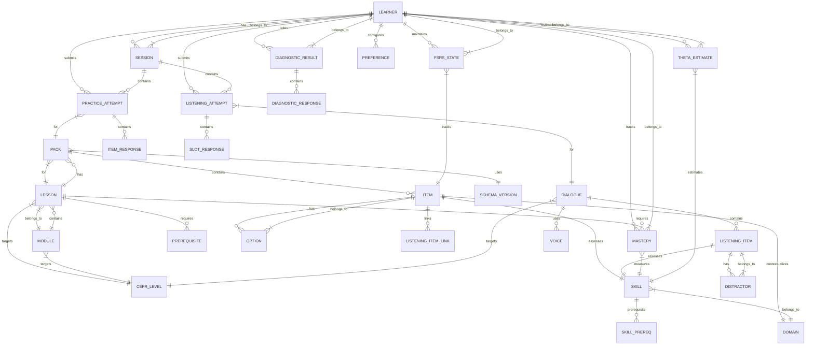

# ITS Platform — Data Model (ERD)

**Version:** 0.1.0-draft · **Source:** `Curso-de-Ingles/ITS-ARCHITECTURE.md` §7
**Database:** PostgreSQL 16+ with pgvector extension

---

## Entity-Relationship Diagram



---

## Table Definitions

### Core Tables

```sql
-- Learners (anonymized, no PII required)
CREATE TABLE learners (
    id              UUID PRIMARY KEY DEFAULT gen_random_uuid(),
    created_at      TIMESTAMPTZ NOT NULL DEFAULT now(),
    cefr_level      VARCHAR(3) NOT NULL CHECK (cefr_level ~ '^A[12]|B[12]|C[12]$'),
    streak_days     INT NOT NULL DEFAULT 0,
    xp              INT NOT NULL DEFAULT 0,
    last_active_at  TIMESTAMPTZ
);

-- Preferences (JSONB for flexibility)
CREATE TABLE learner_preferences (
    learner_id      UUID PRIMARY KEY REFERENCES learners(id) ON DELETE CASCADE,
    recast_enabled  BOOLEAN NOT NULL DEFAULT true,
    meta_button_enabled BOOLEAN NOT NULL DEFAULT true,
    audio_autoplay  BOOLEAN NOT NULL DEFAULT false,
    daily_goal_minutes INT NOT NULL DEFAULT 15,
    ui_language     VARCHAR(5) NOT NULL DEFAULT 'pt-BR',
    updated_at      TIMESTAMPTZ NOT NULL DEFAULT now()
);

-- Sessions (learning sessions)
CREATE TABLE sessions (
    id              UUID PRIMARY KEY DEFAULT gen_random_uuid(),
    learner_id      UUID NOT NULL REFERENCES learners(id) ON DELETE CASCADE,
    started_at      TIMESTAMPTZ NOT NULL DEFAULT now(),
    ended_at        TIMESTAMPTZ,
    device_type     VARCHAR(20),
    is_offline      BOOLEAN NOT NULL DEFAULT false
);

-- CEFR Levels (reference)
CREATE TABLE cefr_levels (
    code            VARCHAR(3) PRIMARY KEY CHECK (code ~ '^A[12]|B[12]|C[12]$'),
    label           VARCHAR(50) NOT NULL,
    sort_order      INT NOT NULL
);

-- Modules
CREATE TABLE modules (
    id              VARCHAR(50) PRIMARY KEY,  -- mod_a1_foundation
    cefr_level      VARCHAR(3) NOT NULL REFERENCES cefr_levels(code),
    theme           VARCHAR(100) NOT NULL,
    sort_order      INT NOT NULL,
    expected_lessons INT NOT NULL DEFAULT 6
);

-- Lessons
CREATE TABLE lessons (
    id              VARCHAR(50) PRIMARY KEY,  -- les_a1_alphabet_sounds
    module_id       VARCHAR(50) NOT NULL REFERENCES modules(id),
    title           VARCHAR(200) NOT NULL,
    cefr_level      VARCHAR(3) NOT NULL REFERENCES cefr_levels(code),
    reuse_basis     VARCHAR(30) NOT NULL CHECK (reuse_basis IN ('cite_only','adapt_with_attribution','adapt_requires_permission')),
    status          VARCHAR(20) NOT NULL CHECK (status IN ('authored','specified','unauthored','blocked','withdrawn')),
    source_ref      TEXT,
    created_at      TIMESTAMPTZ NOT NULL DEFAULT now(),
    updated_at      TIMESTAMPTZ NOT NULL DEFAULT now()
);

-- Lesson Prerequisites (DAG edges)
CREATE TABLE lesson_prerequisites (
    lesson_id       VARCHAR(50) NOT NULL REFERENCES lessons(id) ON DELETE CASCADE,
    prereq_id       VARCHAR(50) NOT NULL REFERENCES lessons(id) ON DELETE CASCADE,
    edge_type       VARCHAR(20) NOT NULL DEFAULT 'prerequisite',
    PRIMARY KEY (lesson_id, prereq_id)
);

-- Skills (from curriculum-graph-spec.md)
CREATE TABLE skills (
    id              VARCHAR(50) PRIMARY KEY,  -- grammar.present_simple, vocab.greetings
    domain          VARCHAR(30) NOT NULL,     -- grammar, vocab, reading, pronunciation, listening, coherence
    label           VARCHAR(100) NOT NULL,
    description     TEXT
);

-- Skill Prerequisites
CREATE TABLE skill_prerequisites (
    skill_id        VARCHAR(50) NOT NULL REFERENCES skills(id) ON DELETE CASCADE,
    prereq_id       VARCHAR(50) NOT NULL REFERENCES skills(id) ON DELETE CASCADE,
    PRIMARY KEY (skill_id, prereq_id)
);

-- Domains
CREATE TABLE domains (
    id              VARCHAR(30) PRIMARY KEY,  -- grammar, vocab, reading, pronunciation, listening, coherence
    label           VARCHAR(50) NOT NULL
);

-- Packs
CREATE TABLE packs (
    id              VARCHAR(100) PRIMARY KEY,  -- pack-les-a1-alphabet-sounds
    lesson_id       VARCHAR(50) NOT NULL REFERENCES lessons(id),
    schema_version  VARCHAR(20) NOT NULL CHECK (schema_version IN ('canonical','legacy_v1')),
    reuse_basis     VARCHAR(30) NOT NULL CHECK (reuse_basis IN ('cite_only','adapt_with_attribution','adapt_requires_permission')),
    created_at      TIMESTAMPTZ NOT NULL DEFAULT now()
);

-- Items (Assessment Items)
CREATE TABLE items (
    id              VARCHAR(100) PRIMARY KEY,  -- grm_grammar.present_simple_01
    skill_id        VARCHAR(50) NOT NULL REFERENCES skills(id),
    domain_id       VARCHAR(30) REFERENCES domains(id),  -- Required for coherence
    pack_id         VARCHAR(100) NOT NULL REFERENCES packs(id),
    prompt          TEXT NOT NULL,
    item_type       VARCHAR(20) NOT NULL CHECK (item_type IN ('mcq','production','minimal_pair')),
    br_pt_form      TEXT,  -- Portuguese form for distractor analysis
    created_at      TIMESTAMPTZ NOT NULL DEFAULT now()
);

-- Options (for MCQ items)
CREATE TABLE options (
    id              BIGSERIAL PRIMARY KEY,
    item_id         VARCHAR(100) NOT NULL REFERENCES items(id) ON DELETE CASCADE,
    letter          CHAR(1) NOT NULL CHECK (letter IN ('A','B','C','D')),
    text            TEXT NOT NULL,
    is_key          BOOLEAN NOT NULL,
    note            TEXT,  -- Required distractor rationale
    br_pt_form      TEXT,
    UNIQUE (item_id, letter)
);

-- Listening Corpus
CREATE TABLE dialogues (
    id              VARCHAR(50) PRIMARY KEY,  -- dlg_a1_01_greetings
    title           VARCHAR(200) NOT NULL,
    cefr_level      VARCHAR(3) NOT NULL REFERENCES cefr_levels(code),
    status          VARCHAR(20) NOT NULL CHECK (status IN ('shipped','withdrawn','shadow-only')),
    duration_seconds INT NOT NULL CHECK (duration_seconds >= 45),
    created_at      TIMESTAMPTZ NOT NULL DEFAULT now()
);

-- Dialogue Voices
CREATE TABLE voices (
    id              VARCHAR(20) PRIMARY KEY,  -- v_a, v_b, v_c, v_d
    speaker_name    VARCHAR(50) NOT NULL,
    accent          VARCHAR(50) NOT NULL,
    gender          VARCHAR(10)
);

CREATE TABLE dialogue_voices (
    dialogue_id     VARCHAR(50) NOT NULL REFERENCES dialogues(id) ON DELETE CASCADE,
    voice_id        VARCHAR(20) NOT NULL REFERENCES voices(id),
    PRIMARY KEY (dialogue_id, voice_id)
);

-- Listening Items (slots)
CREATE TABLE listening_items (
    id              VARCHAR(50) PRIMARY KEY,  -- lst_gist_001
    dialogue_id     VARCHAR(50) NOT NULL REFERENCES dialogues(id) ON DELETE CASCADE,
    skill_id        VARCHAR(50) NOT NULL REFERENCES skills(id),  -- gist, detail, inference, lexical, pronunciation
    slot_number     INT NOT NULL,
    key_text        TEXT NOT NULL,
    transcript      TEXT NOT NULL,
    UNIQUE (dialogue_id, slot_number)
);

-- Listening Distractors
CREATE TABLE listening_distractors (
    id              BIGSERIAL PRIMARY KEY,
    listening_item_id VARCHAR(50) NOT NULL REFERENCES listening_items(id) ON DELETE CASCADE,
    letter          CHAR(1) NOT NULL CHECK (letter IN ('A','B','C','D')),
    text            TEXT NOT NULL,
    distractor_type VARCHAR(30) NOT NULL CHECK (distractor_type IN ('semantic_plausible','overgeneralization','phonological','lexical')),
    UNIQUE (listening_item_id, letter)
);

-- Mastery (BKT) per learner per skill
CREATE TABLE mastery (
    learner_id      UUID NOT NULL REFERENCES learners(id) ON DELETE CASCADE,
    skill_id        VARCHAR(50) NOT NULL REFERENCES skills(id),
    mastery         NUMERIC(4,3) NOT NULL CHECK (mastery BETWEEN 0 AND 1),
    gate_passed     BOOLEAN NOT NULL DEFAULT false,
    last_practice_at TIMESTAMPTZ,
    updated_at      TIMESTAMPTZ NOT NULL DEFAULT now(),
    PRIMARY KEY (learner_id, skill_id)
);

-- IRT Theta Estimates per learner per skill
CREATE TABLE theta_estimates (
    learner_id      UUID NOT NULL REFERENCES learners(id) ON DELETE CASCADE,
    skill_id        VARCHAR(50) NOT NULL REFERENCES skills(id),
    theta           NUMERIC(6,3) NOT NULL,
    se              NUMERIC(6,3) NOT NULL CHECK (se > 0),
    ci95_lower      NUMERIC(6,3) NOT NULL,
    ci95_upper      NUMERIC(6,3) NOT NULL,
    evidence_count  INT NOT NULL DEFAULT 0,
    last_updated    TIMESTAMPTZ NOT NULL DEFAULT now(),
    PRIMARY KEY (learner_id, skill_id)
);

-- FSRS States per learner per item
CREATE TABLE fsrs_states (
    learner_id      UUID NOT NULL REFERENCES learners(id) ON DELETE CASCADE,
    item_id         VARCHAR(100) NOT NULL REFERENCES items(id) ON DELETE CASCADE,
    stability       NUMERIC(10,3) NOT NULL CHECK (stability >= 0),
    difficulty      NUMERIC(4,3) NOT NULL CHECK (difficulty BETWEEN 0 AND 10),
    last_review     TIMESTAMPTZ NOT NULL,
    retrievability  NUMERIC(4,3) GENERATED ALWAYS AS (
        CASE WHEN stability > 0 THEN EXP(-EXTRACT(EPOCH FROM (now() - last_review))/86400.0 / stability) ELSE 0 END
    ) STORED,
    PRIMARY KEY (learner_id, item_id)
);

-- Diagnostic Results
CREATE TABLE diagnostic_results (
    id              UUID PRIMARY KEY DEFAULT gen_random_uuid(),
    learner_id      UUID NOT NULL REFERENCES learners(id) ON DELETE CASCADE,
    start_node      VARCHAR(50) NOT NULL REFERENCES lessons(id),
    theta           NUMERIC(6,3) NOT NULL,
    se              NUMERIC(6,3) NOT NULL,
    ci95_lower      NUMERIC(6,3) NOT NULL,
    ci95_upper      NUMERIC(6,3) NOT NULL,
    blueprint_coverage JSONB NOT NULL,
    stopping_rule   VARCHAR(50) NOT NULL,
    created_at      TIMESTAMPTZ NOT NULL DEFAULT now()
);

CREATE TABLE diagnostic_responses (
    id              BIGSERIAL PRIMARY KEY,
    diagnostic_id   UUID NOT NULL REFERENCES diagnostic_results(id) ON DELETE CASCADE,
    item_id         VARCHAR(100) NOT NULL,
    skill_id        VARCHAR(50) NOT NULL REFERENCES skills(id),
    correct         BOOLEAN NOT NULL,
    response_time_ms INT NOT NULL,
    theta_after     NUMERIC(6,3) NOT NULL,
    se_after        NUMERIC(6,3) NOT NULL
);

-- Practice Attempts
CREATE TABLE practice_attempts (
    id              UUID PRIMARY KEY DEFAULT gen_random_uuid(),
    session_id      UUID NOT NULL REFERENCES sessions(id) ON DELETE CASCADE,
    learner_id      UUID NOT NULL REFERENCES learners(id) ON DELETE CASCADE,
    pack_id         VARCHAR(100) NOT NULL REFERENCES packs(id),
    started_at      TIMESTAMPTZ NOT NULL DEFAULT now(),
    completed_at    TIMESTAMPTZ,
    total_items     INT NOT NULL,
    correct_count   INT NOT NULL DEFAULT 0
);

CREATE TABLE item_responses (
    id              BIGSERIAL PRIMARY KEY,
    attempt_id      UUID NOT NULL REFERENCES practice_attempts(id) ON DELETE CASCADE,
    item_id         VARCHAR(100) NOT NULL REFERENCES items(id),
    response        TEXT,
    correct         BOOLEAN,  -- NULL for production items
    response_time_ms INT NOT NULL,
    confidence      NUMERIC(3,2),  -- 0.00-1.00
    bkt_prior       NUMERIC(4,3) NOT NULL,
    bkt_posterior   NUMERIC(4,3) NOT NULL,
    bkt_transition  VARCHAR(20) NOT NULL CHECK (bkt_transition IN ('learned','retained','forgot','guessed')),
    created_at      TIMESTAMPTZ NOT NULL DEFAULT now()
);

-- Listening Attempts
CREATE TABLE listening_attempts (
    id              UUID PRIMARY KEY DEFAULT gen_random_uuid(),
    session_id      UUID NOT NULL REFERENCES sessions(id) ON DELETE CASCADE,
    learner_id      UUID NOT NULL REFERENCES learners(id) ON DELETE CASCADE,
    dialogue_id     VARCHAR(50) NOT NULL REFERENCES dialogues(id),
    started_at      TIMESTAMPTZ NOT NULL DEFAULT now(),
    completed_at    TIMESTAMPTZ,
    total_slots     INT NOT NULL,
    correct_count   INT NOT NULL DEFAULT 0
);

CREATE TABLE slot_responses (
    id              BIGSERIAL PRIMARY KEY,
    attempt_id      UUID NOT NULL REFERENCES listening_attempts(id) ON DELETE CASCADE,
    listening_item_id VARCHAR(50) NOT NULL REFERENCES listening_items(id),
    response_letter CHAR(1) CHECK (response_letter IN ('A','B','C','D')),
    correct         BOOLEAN NOT NULL,
    response_time_ms INT NOT NULL,
    created_at      TIMESTAMPTZ NOT NULL DEFAULT now()
);

-- Indexes for query performance
CREATE INDEX idx_mastery_learner ON mastery(learner_id);
CREATE INDEX idx_theta_learner ON theta_estimates(learner_id);
CREATE INDEX idx_fsrs_learner ON fsrs_states(learner_id);
CREATE INDEX idx_practice_learner ON practice_attempts(learner_id, started_at DESC);
CREATE INDEX idx_listening_learner ON listening_attempts(learner_id, started_at DESC);
CREATE INDEX idx_items_pack ON items(pack_id);
CREATE INDEX idx_items_skill ON items(skill_id);
```

---

## Vector Embeddings (pgvector)

```sql
-- For semantic search over lesson/pack content
CREATE EXTENSION IF NOT EXISTS vector;

CREATE TABLE content_embeddings (
    id              BIGSERIAL PRIMARY KEY,
    content_type    VARCHAR(20) NOT NULL CHECK (content_type IN ('lesson','pack','dialogue')),
    content_id      VARCHAR(100) NOT NULL,
    chunk_index     INT NOT NULL,
    text            TEXT NOT NULL,
    embedding       VECTOR(1536),  -- OpenAI text-embedding-3-small or local
    metadata        JSONB,
    UNIQUE (content_type, content_id, chunk_index)
);

CREATE INDEX idx_embeddings_hnsw ON content_embeddings
USING hnsw (embedding vector_cosine_ops);
```

---

## Migration Strategy

| Migration | Source Spec | Tool |
|---|---|---|
| Lessons → `lessons` table | `curriculum-graph-spec.md` §4.3 registry | Custom ETL from markdown |
| Packs → `packs` + `items` + `options` | `post-lesson-practice-spec.md` two schemas | Parser per schema |
| Listening → `dialogues` + `listening_items` | `listening-corpus-spec.md` + `listening-corpus.md` | Custom parser |
| Skills → `skills` | `curriculum-graph-spec.md` §1.1 + §4.3 | Extracted from registry |

---

## Invariants (Enforced by CHECK constraints + triggers)

1. **Mastery gate**: `gate_passed = (mastery >= 0.85)` — trigger on UPDATE
2. **BKT bounds**: `mastery ∈ [0,1]` — CHECK constraint
3. **IRT CI95**: `ci95_lower = theta - 1.96*se`, `ci95_upper = theta + 1.96*se` — trigger
4. **Pack item count**: canonical packs = 7 items; legacy packs = 7 items — CHECK on insert
5. **Option distinctness**: per item, option texts must be distinct (case-sensitive, bold stripped) — trigger
6. **Key uniqueness**: exactly one `is_key=true` per item — CHECK constraint
7. **Listening duration**: `duration_seconds >= 45` — CHECK constraint
8. **Status vocabulary**: only `shipped/withdrawn/shadow-only` — CHECK constraint
9. **DAG acyclicity**: application-level check on `lesson_prerequisites` insert