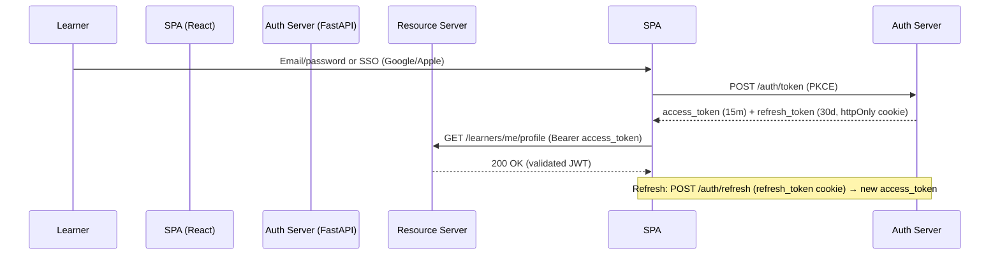

# ITS Platform — Security Specification

**Version:** 0.1.0-draft · **Classification:** Internal
**Source:** `Curso-de-Ingles/ITS-ARCHITECTURE.md` §8
**Compliance:** LGPD (Lei 13.709/2018), GDPR (where applicable), OWASP ASVS 4.0 Level 2

---

## 1. Threat Model Overview (STRIDE)

| Threat Category | Applicability | Mitigation |
|---|---|---|
| **Spoofing** | High — JWT tokens, session hijacking | Short-lived access tokens (15m), PKCE, refresh token rotation, device binding |
| **Tampering** | High — mastery/θ manipulation, practice responses | Server-side validation, immutable event log, BKT/IRT updates only via worker |
| **Repudiation** | Medium — learner actions, consent | Audit log with cryptographic chaining, signed consent records |
| **Information Disclosure** | High — θ estimates, mastery, audio, PII | Encryption at rest (AES-256), TLS 1.3, field-level encryption for θ, audio access via signed URLs |
| **Denial of Service** | Medium — adaptive engine, audio streaming | Rate limiting, circuit breakers, async processing via Celery, CDN for audio |
| **Elevation of Privilege** | Medium — role escalation (learner→teacher→admin) | RBAC with least privilege, attribute-based access for content |

---

## 2. Authentication & Authorization

### 2.1 Authentication Flow



### 2.2 Token Specifications

| Token | Lifetime | Storage | Rotation | Revocation |
|---|---|---|---|---|
| Access Token (JWT) | 15 minutes | Memory (SPA) | N/A | Immediate via blocklist |
| Refresh Token (Opaque) | 30 days | httpOnly Secure cookie (SameSite=Strict) | Rotated on use | Immediate via DB flag |
| Device Token | 90 days | Secure enclave / Keychain | On re-auth | Per-device revocation |

**JWT Claims:**
```json
{
  "sub": "learner_uuid",
  "iat": 1700000000,
  "exp": 1700000900,
  "jti": "unique_token_id",
  "roles": ["learner"],
  "permissions": ["read:own_profile", "submit:practice", "read:content"],
  "device_id": "device_uuid"
}
```

### 2.3 Role-Based Access Control (RBAC)

| Role | Permissions | Assignment |
|---|---|---|
| `learner` | `read:own_profile`, `submit:practice`, `read:content`, `read:own_mastery`, `read:own_theta` | Default on registration |
| `teacher` | `learner` + `read:class_mastery`, `read:class_progress`, `assign:content`, `view:reports` | Manual by admin |
| `author` | `teacher` + `write:lesson`, `write:pack`, `write:listening`, `manage:reuse_basis` | Manual by admin |
| `admin` | All permissions + `manage:users`, `manage:roles`, `view:audit_log`, `manage:config` | Manual by super-admin |

### 2.4 Attribute-Based Access Control (ABAC) for Content

```rego
# OPA policy example
package its.authz

allow_read_content(user, content) {
    content.reuse_basis == "cite_only"
}

allow_read_content(user, content) {
    content.reuse_basis == "adapt_with_attribution"
    user.role in {"learner", "teacher", "author", "admin"}
}

allow_read_content(user, content) {
    content.reuse_basis == "adapt_requires_permission"
    user.role in {"author", "admin"}
    permissions[user.id][content.id] == "granted"
}

deny_write_content(user, content) {
    content.status in {"blocked", "withdrawn"}
    user.role != "admin"
}
```

---

## 3. Data Protection (LGPD/GDPR)

### 3.1 Data Classification

| Data Type | Classification | Retention | Encryption | Access |
|---|---|---|---|---|
| Learner UUID | Pseudonymized | Account lifetime + 1 year | AES-256 at rest | Learner, Teacher, Admin |
| Mastery (BKT) | Learning analytics | Account lifetime + 1 year | AES-256 at rest | Learner, Teacher, Admin |
| Theta (IRT) | Learning analytics | Account lifetime + 1 year | **Field-level AES-256** | Learner, Teacher, Admin |
| FSRS States | Learning analytics | Account lifetime + 1 year | AES-256 at rest | Learner, Teacher, Admin |
| Practice Responses | Learning analytics | 2 years | AES-256 at rest | Learner, Teacher, Admin |
| Audio Responses | Biometric (voice) | 30 days (opt-in) | AES-256 at rest + KMS | Learner only (unless consent) |
| Diagnostic Results | Learning analytics | Account lifetime + 1 year | AES-256 at rest | Learner, Teacher, Admin |
| Consent Records | Legal | 10 years | AES-256 at rest | Admin, DPO |
| Audit Logs | Security | 2 years | Append-only, signed | Admin, Security |

### 3.2 Lawful Basis

| Processing Purpose | LGPD Art. 7 Basis | GDPR Art. 6 Basis |
|---|---|---|
| Adaptive learning (BKT/IRT/FSRS) | VII — Legitimate interest / Consent | 6(1)(a) Consent / 6(1)(f) Legitimate interest |
| Progress reporting to teachers | VII — Legitimate interest | 6(1)(f) Legitimate interest |
| Audio for pronunciation scoring | VIII — Explicit consent | 9(2)(a) Explicit consent |
| Security monitoring | IX — Legal obligation | 6(1)(c) Legal obligation |
| Analytics (aggregated, anonymized) | VII — Legitimate interest | 6(1)(f) Legitimate interest |

### 3.3 Data Subject Rights Implementation

| Right | Implementation | SLA |
|---|---|---|
| Access (Art. 18 LGPD / Art. 15 GDPR) | `GET /learners/me/data-export` → JSON + PDF | 15 days |
| Rectification (Art. 16 LGPD / Art. 16 GDPR) | `PATCH /learners/me/profile` (limited fields) | 15 days |
| Erasure (Art. 18 LGPD / Art. 17 GDPR) | `DELETE /learners/me` → hard delete + audit log | 30 days |
| Portability (Art. 18 LGPD / Art. 20 GDPR) | Included in data export (JSON) | 15 days |
| Restriction (Art. 18 LGPD / Art. 18 GDPR) | `POST /learners/me/restrict` → freeze processing | 15 days |
| Objection (Art. 18 LGPD / Art. 21 GDPR) | `POST /learners/me/object` → stop profiling | 15 days |

### 3.4 Consent Management

```sql
CREATE TABLE consents (
    id              UUID PRIMARY KEY DEFAULT gen_random_uuid(),
    learner_id      UUID NOT NULL REFERENCES learners(id) ON DELETE CASCADE,
    purpose         VARCHAR(50) NOT NULL,  -- 'pronunciation_audio', 'analytics', 'marketing'
    granted         BOOLEAN NOT NULL,
    granted_at      TIMESTAMPTZ,
    withdrawn_at    TIMESTAMPTZ,
    version         VARCHAR(20) NOT NULL,  -- consent form version
    ip_hash         CHAR(64),              -- SHA-256 of IP at consent time
    user_agent_hash CHAR(64),
    UNIQUE (learner_id, purpose, version)
);
```

---

## 4. Cryptography

| Purpose | Algorithm | Key Management |
|---|---|---|
| Data at rest (DB) | AES-256-GCM | AWS KMS / HashiCorp Vault (envelope encryption) |
| Field-level (θ, audio refs) | AES-256-GCM | Per-field DEK wrapped by KMS master key |
| TLS | TLS 1.3 (ECDHE + AES-256-GCM) | ACM / Let's Encrypt (auto-renew) |
| JWT signing | RS256 (RSA-2048 min) | KMS-managed keys, rotated quarterly |
| Password hashing | Argon2id (t=3, m=64MB, p=4) | N/A |
| Refresh token storage | PBKDF2-HMAC-SHA256 (100k iter) | N/A |
| Audit log chaining | SHA-256 (hash chain) | N/A |
| Signed URLs (audio) | HMAC-SHA256 | Rotating signing key in KMS |

---

## 5. Network Security

| Layer | Control |
|---|---|
| **Edge** | Cloudflare WAF (OWASP Top 10 managed ruleset), DDoS protection, Bot management |
| **API Gateway** | Kong / AWS API Gateway: rate limiting (100 req/min/learner), JWT validation, request/response transformation |
| **VPC** | Private subnets for API workers, DB, Redis; NAT Gateway for egress; no direct internet access |
| **Service Mesh** | Istio mTLS between services; authorization policies per namespace |
| **Database** | PostgreSQL: SSL required, row-level security (RLS) on `learner_id`, `pg_audit` extension |
| **Redis** | AUTH + TLS, separate DBs per service (sessions, cache, queue) |
| **Object Store** | S3: bucket policies, SSE-KMS, versioning, lifecycle rules (audio 30d) |

---

## 6. Application Security

| Control | Implementation |
|---|---|
| **Input Validation** | Pydantic v2 on all request bodies; strict enums, regex patterns for IDs |
| **Output Encoding** | Jinja2 auto-escape for server-rendered; React auto-escape for SPA |
| **SQL Injection** | SQLAlchemy ORM only; no raw SQL except migrations |
| **XSS Prevention** | CSP: `default-src 'self'; script-src 'self' 'nonce-...'; style-src 'self' 'unsafe-inline'; img-src 'self' data: https:; connect-src 'self' wss://api.its.example.com; frame-ancestors 'none'` |
| **CSRF** | SameSite=Strict cookies; Double-submit cookie pattern for state-changing ops |
| **Dependency Scanning** | `pip-audit` + `safety` in CI; `dependabot` alerts; `pip-compile` for pinned deps |
| **SAST** | `bandit` + `semgrep` (OWASP Top 10 rules) in CI |
| **Container Scanning** | `trivy` on Docker images in CI; base image `python:3.11-slim` |
| **Secrets** | No secrets in code; all via Vault/Secrets Manager; `git-secrets` pre-commit hook |

---

## 7. Audio Data Handling (Special Category)

```python
# Pseudocode for audio upload flow
async def upload_audio(learner_id: UUID, audio_bytes: bytes, purpose: str) -> str:
    # 1. Verify consent
    consent = await db.fetchone("""
        SELECT granted FROM consents
        WHERE learner_id = $1 AND purpose = $2 AND granted = true
    """, learner_id, purpose)
    if not consent:
        raise Forbidden("Consent required for audio upload")

    # 2. Scan for malware
    await clamav_scan(audio_bytes)

    # 3. Transcode to Opus (low bandwidth, good quality)
    opus_bytes = await ffmpeg_transcode(audio_bytes, "opus", bitrate="32k")

    # 4. Encrypt with per-learner DEK
    encrypted = await kms.encrypt(opus_bytes, context={"learner_id": str(learner_id)})

    # 5. Store in S3 with lifecycle (30 days)
    object_key = f"audio/{learner_id}/{uuid4()}.opus.enc"
    await s3.put_object(
        Bucket=AUDIO_BUCKET,
        Key=object_key,
        Body=encrypted,
        ServerSideEncryption="aws:kms",
        Tagging=f"learner_id={learner_id}&purpose={purpose}&expires={(now+30d).isoformat()}"
    )

    # 6. Return signed URL for ASR worker (5 min TTL)
    return await s3.generate_presigned_url("get_object", Params={"Bucket": AUDIO_BUCKET, "Key": object_key}, ExpiresIn=300)
```

---

## 8. Incident Response (Security)

| Phase | Action | Owner | SLA |
|---|---|---|---|
| **Detect** | Alert from WAF, audit log anomaly, vulnerability scan | Security Engineer | < 15 min |
| **Triage** | Severity classification (P1-P4), evidence preservation | Security Lead | < 1 hour |
| **Contain** | Revoke tokens, block IPs, isolate affected pods | Platform Engineer | < 2 hours (P1) |
| **Eradicate** | Patch vuln, rotate keys, rebuild images | Platform Engineer | < 24 hours (P1) |
| **Recover** | Restore from backup, verify integrity, gradual rollout | Platform Engineer | < 48 hours (P1) |
| **Postmortem** | Blameless postmortem, action items, update runbook | Security Lead | < 5 business days |

**Notification:**
- P1 (data breach): DPO + ANPD (LGPD) within 48 hours; affected learners within 72 hours
- P2 (vulnerability exploit): Security team + affected users if PII exposed
- P3/P4: Internal tracking only

---

## 9. Compliance Checklist

| Requirement | Status | Evidence |
|---|---|---|
| LGPD Art. 7 — Lawful basis documented | ✅ | This spec §3.2 |
| LGPD Art. 18 — Data subject rights implemented | ✅ | This spec §3.3 |
| LGPD Art. 46 — International transfer safeguards | ✅ | AWS SA regions, SCCs |
| LGPD Art. 48 — DPO appointed | 🟡 | To be assigned pre-launch |
| GDPR Art. 25 — Data protection by design | ✅ | Field-level encryption, minimization |
| GDPR Art. 30 — Records of processing (ROPA) | 🟡 | To be documented pre-launch |
| GDPR Art. 32 — Security of processing | ✅ | This spec §4–§6 |
| GDPR Art. 33 — Breach notification (72h) | ✅ | This spec §8 |
| OWASP ASVS 4.0 L2 | 🟡 | Gap analysis in CI |
| ISO 27001 Annex A | 🟡 | Mapping in progress |

---

## 10. Open Questions

| # | Question | Decision By |
|---|---|---|
| 1 | Biometric classification of voice audio under LGPD Art. 11? | Legal review pre-M5 |
| 2 | Cross-border transfer: learners in EU? | Product decision pre-M1 |
| 3 | Parental consent for learners < 18? | Legal review pre-M1 |
| 4 | Encryption key rotation policy for field-level DEKs? | Security review pre-M3 |
| 5 | Retention period for aggregated analytics? | DPO decision pre-M7 |